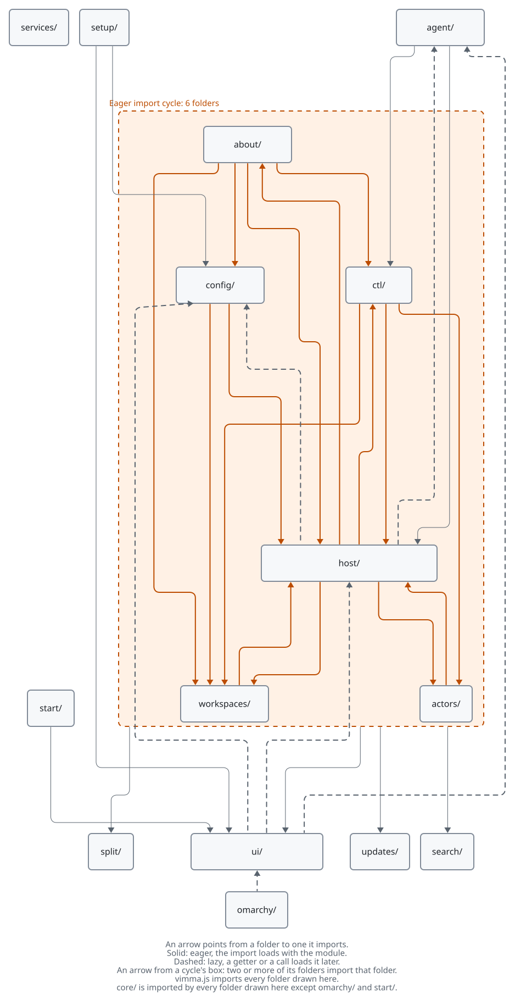

# Architecture

This page is the map of Vimma's code: what Vimma adds on top of Firefox, which processes take
part when it runs, what each folder holds, how the folders depend on each other today, and where
the trust boundaries are. It is written for someone who has not worked on Vimma before. It names
folders and roles, not line numbers; the feature specs in [docs/specs/](docs/specs/) and the
decisions in [docs/adr/](docs/adr/) hold the detail, and [docs/README.md](docs/README.md) says
which page to read for what. The walkthroughs in [docs/architecture/](docs/architecture/) follow
one flow each through the code, step by step.

## What Vimma adds to Firefox

Vimma is Firefox with a keyboard layer, workspaces, split panes, a status bar and local AI agent
access added to its browser window. Gecko (page rendering, networking, the sandbox) is Firefox's,
unchanged. Firefox's browser window is itself written in JavaScript, CSS and XHTML, so nearly
everything Vimma adds is front-end code that runs in the browser's own privileged ("chrome")
context ([ADR-001](docs/adr/001-engine-firefox-surfer.md)).

The fork is built with [Surfer](https://github.com/zen-browser/surfer), the toolchain Zen Browser
uses:

- `surfer.json` pins the Firefox release Vimma is built on. `npx surfer download` fetches that
  release's source into `engine/` (git-ignored, never edited by hand); `npm run import` refuses
  an `engine/` whose source was not checked against Mozilla's signature
  (`tools/upstream/verify-source.sh`, [ADR-021](docs/adr/021-mozilla-release-key.md)), then
  lays `src/` over it.
- `src/` mirrors Firefox's source tree. Whole files are Vimma's own and are linked into `engine/`
  at the same path; `*.patch` files are small edits to upstream files, applied by Surfer.
- Vimma's code lives in its own files under `src/browser/base/content/vimma/`; an upstream file is
  patched only to load them, in the smallest hunk possible
  ([ADR-003](docs/adr/003-own-files-minimal-patches.md), which keeps the register of every
  patch). The one that matters most is `src/browser/base/content/browser-xhtml.patch`: it adds a
  `<script>` tag that loads `vimma/vimma.js` into every browser window. About 25 patches exist
  today: 10 change user-facing strings, the other 15 wire Vimma in or adjust one Firefox
  behaviour. `patch-audit.yml` reviews them every quarter.
- `packages/vimma-core` is Vimma's logic with no Firefox in it
  ([ADR-005](docs/adr/005-pure-core-package.md)). `npm run sync-core` copies it into
  `src/browser/base/content/vimma/core/` (git-ignored), where the chrome code imports it.
- Code is JavaScript ES modules with JSDoc types, checked by `tsc --checkJs`
  ([ADR-004](docs/adr/004-javascript-jsdoc.md)). The Node-side tools under `tools/` are moving to
  TypeScript that Node runs as it is, by erasing the types, with no build step
  ([ADR-025](docs/adr/025-typescript-for-tools.md)); `tools/vimma-ctl` is Rust
  ([ADR-011](docs/adr/011-vimma-ctl-rust.md)).

There are two ways to build. A **full build** compiles all of Firefox (about 40 minutes) and is
what releases, the nightly and macOS ship. An **artifact build** puts Vimma's front end on top of
Mozilla's own compiled binaries for the same release, takes under a minute when warm, and is what
pull requests test ([ADR-010](docs/adr/010-pr-artifact-builds.md)). A change to a `.patch`
file, C++, `moz.build`, `configs/` or branding needs a full build to verify. Commands:
[CONTRIBUTING.md](CONTRIBUTING.md) and [docs/runbook.md](docs/runbook.md).

## The running system

<picture>
  <source media="(prefers-color-scheme: dark)" srcset="docs/assets/diagrams/system-dark.svg">
  <source media="(prefers-color-scheme: light)" srcset="docs/assets/diagrams/system-light.svg">
  
</picture>

The picture is drawn from [docs/assets/diagrams/system.d2](docs/assets/diagrams/system.d2); the
dashed boxes and the yellow content-process box are the trust boundaries, and the blue arrows
cross a boundary in the parent: into `ctl/` past the control socket's token (the built-in
agent's commands come from inside the process), and from `ctl/` past the agent gate,
`host/AgentGate.sys.mjs`. In words:

- **Parent process.** Firefox runs every browser window in one privileged process. `vimma.js` runs
  in each window and starts Vimma's modules there; most of them are one per app (the module is
  shared by every window), some keep state per window. All of Vimma's own UI (status bar, command
  line, pickers, side panel, help overlay, agent prompt) is HTML and CSS in this process.
- **Content processes.** Web pages run in sandboxed processes. Vimma reaches them only through
  one JSWindowActor pair: `VimmaChild` runs in every frame and reports focus changes, scrolls,
  collects link hints, drives the caret, searches text; `VimmaParent` (`host/VimmaParent.sys.mjs`)
  hands its reports to the host, and the host sends commands through `actors/VimmaActors.sys.mjs`.
- **The control socket.** Off by default. A local TCP server on 127.0.0.1 and a random port,
  speaking JSON lines; a client proves it holds the token in `<profile>/vimma-control.json`
  (mode 0600) before any command ([ADR-007](docs/adr/007-control-socket.md),
  [spec](docs/specs/m0-control-protocol-and-vimma-ctl.md)). Protocol 2 has two roles: `full`
  (keys, state, open, theme; the pref `vimma.control.enabled`) and `agent` (only the agent
  commands, confined to the agent workspace and asked of the user; `[mcp] enabled` or `:mcp on`,
  [spec](docs/specs/vimma-mcp.md), [ADR-019](docs/adr/019-agents-over-mcp.md)). One call's way
  through it: [The life of an agent call](docs/architecture/agent-call.md).
- **vimma-ctl.** One Rust binary, shipped next to the browser: `vimma-ctl <command>` is the
  scripting client (the `full` role, as is the e2e harness in `tools/e2e/`), and `vimma-ctl mcp`
  is an MCP server over stdio that an AI agent host starts, which connects to the browser as the
  `agent` role.
- **The built-in agent.** A chat window inside Vimma. Its model calls go straight to the
  provider's HTTP API; its tool calls go through the same gate, grants and log as an outside
  agent's, in process, with no socket or token; a task sent with `Enter` grants its own
  conversation's connection without a question, until the task ends. It can also run an agent CLI as a subprocess, whose only MCP server is
  `vimma-ctl mcp` with a one-time ticket ([builtin-agent](docs/specs/builtin-agent.md),
  [builtin-agent-cli](docs/specs/builtin-agent-cli.md)).
- **Outside the browser.** The update check reads a signed manifest from updates.vimma.dev,
  where the release pipeline publishes it; the update file (MAR) it names is downloaded from the
  release on GitHub (not drawn). A model provider is reached over HTTPS, or over HTTP when it
  runs on this machine ([m6a-updater](docs/specs/m6a-updater.md), [ADR-016](docs/adr/016-own-update-channel.md)).
  `config.toml` and the Omarchy theme file are polled every 2 s, because Firefox has no portable
  file watcher. Omarchy's theme-set hook makes the theme reload at once through Firefox's
  command-line remoting. On Hyprland, the private workspace can swap in place of the window
  through Hyprland's IPC sockets, one for requests and one for the events Vimma listens to ([ADR-017](docs/adr/017-window-manager-ipc.md)).

## How a key is handled

1. `host/VimmaHost.sys.mjs` listens for `keydown` on the browser window in the capture phase, so
   it sees a key before the address bar, Firefox's own pages, the PDF viewer and the page. The
   one exception is a page-first binding: its key goes to the page first, and Vimma acts only if
   the page left it alone ([firefox-keys](docs/specs/firefox-keys.md), decision 6).
2. It turns the event into a chord (`ctrl+b`, `shift+t`) and asks vimma-core's dispatcher what it
   means in the current mode. The modes are `normal`, `insert`, `visual`, `command`, `hint`,
   `element`, `help`, `panel`, `resize` and `index`; a pending `ctrl+b` prefix is tracked by the
   dispatcher itself (`packages/vimma-core/src/keys/modes.mjs`).
3. The dispatcher answers with an action, "pending" (more keys may follow), "cancel" (a pending
   sequence ends with no action, such as an unknown key after `ctrl+b`) or "pass". A key that
   passes reaches Firefox and the page untouched.
4. An action is a name from the closed list in `packages/vimma-core/src/keys/actions.mjs`.
   `host/runners.mjs` holds the action tables, which `VimmaHost.sys.mjs` dispatches to. A chrome
   action runs in the browser window (tab, pane, workspace, picker and others, through the
   `host/*-ops.mjs` modules); a page action goes to the focused page through the actor (scroll,
   hints, caret, find).
5. The status bar, help overlay and pickers redraw from the same state. `ctrl+b ?` renders the
   binding table the dispatcher uses, so the help cannot drift from the keys.

The keymap is vimma-core's defaults (`defaults.mjs`) merged with the user's `config.toml`; every
key, the prefix and the leader can be remapped. `npm run gen-docs` writes
[docs/bindings.md](docs/bindings.md) from the same tables. Which keys Vimma takes from Firefox and
from pages: [docs/specs/firefox-keys.md](docs/specs/firefox-keys.md) and
[ADR-024](docs/adr/024-keymap-contexts.md). Step by step, with the code that carries a key:
[The life of a keypress](docs/architecture/keypress.md).

## Module map

### `src/browser/base/content/vimma/`

`vimma.js` is the entry point. It starts the modules in a fixed order, each step commented with
its reason: the process-wide services (the app launcher first, before anything starts Firefox's
shell service), the start page, `about:vimma`, the address bar's rows, the actors, the theme and
the Omarchy hook, the host, workspaces, split panes, `config.toml`, the first-run setup, the
update check, the control server, the agent modules and the private-workspace swap. `jar.mn` lists
every file that ships; `moz.build` adds the folder to the build.

| Folder              | Role                                                                                                                                                                                                                                                                                                                                                                                                                                                                                                                                                                                                                                                               |
| ------------------- | ------------------------------------------------------------------------------------------------------------------------------------------------------------------------------------------------------------------------------------------------------------------------------------------------------------------------------------------------------------------------------------------------------------------------------------------------------------------------------------------------------------------------------------------------------------------------------------------------------------------------------------------------------------------ |
| `vimma/host/`       | `VimmaHost.sys.mjs`: key capture, dispatch through vimma-core, modes and window state. `runners.mjs`: the action tables, what each action does. The `*-ops.mjs` files apply one area's actions to Firefox (tabs, panes, workspaces, bookmarks, downloads, permissions, PDF, MCP). `AgentGate.sys.mjs`: the agent gate, which every agent command asks and whose questions the agent line shows. `VimmaParent.sys.mjs`: the parent side of the JSWindowActor pair, which hands page reports to the host and the PDF code. `hypr/HyprIpc.sys.mjs` talks to Hyprland's IPC sockets, checked against core's whitelist ([ADR-017](docs/adr/017-window-manager-ipc.md)). |
| `vimma/actors/`     | The JSWindowActor pair's registration and child (`VimmaActors`, `VimmaChild`; the parent, `VimmaParent`, is in `host/`) and what runs in the page: hint collection, caret and text model, Enter key, the PDF viewer, live grep's matcher and its worker.                                                                                                                                                                                                                                                                                                                                                                                                           |
| `vimma/ui/`         | Vimma's own UI in the browser window: status bar, command line, help overlay, hints overlay, pickers, side panel, bookmarks panel, prompts, notices, the agent chat window, the theme (`theme-host.mjs`).                                                                                                                                                                                                                                                                                                                                                                                                                                                          |
| `vimma/workspaces/` | Workspaces as Firefox containers: the app's workspace definitions and their file, each window's tab membership and hidden tabs, and the `[[routes]]` rules that send a URL to a workspace.                                                                                                                                                                                                                                                                                                                                                                                                                                                                         |
| `vimma/split/`      | Split panes on Firefox's own split view ([ADR-013](docs/adr/013-split-on-firefox-split-view.md)): the window's pane tree and the CSS geometry.                                                                                                                                                                                                                                                                                                                                                                                                                                                                                                                     |
| `vimma/config/`     | `ConfigHost.sys.mjs`: reads and polls `config.toml`, hands each validated part to the module that uses it, keeps the last good config on an error.                                                                                                                                                                                                                                                                                                                                                                                                                                                                                                                 |
| `vimma/ctl/`        | The control socket server (`VimmaControl.sys.mjs`) and the agent commands: open, read, keys, elements, fill, activate, screenshot, console, downloads, page limits. Each asks the agent gate in `host/` first.                                                                                                                                                                                                                                                                                                                                                                                                                                                     |
| `vimma/agent/`      | The built-in agent: conversations, agent CLI runs, API keys in the OS keyring, encrypted stored conversations.                                                                                                                                                                                                                                                                                                                                                                                                                                                                                                                                                     |
| `vimma/updates/`    | The update check and the AppImage's self-update ([m6a-updater](docs/specs/m6a-updater.md)).                                                                                                                                                                                                                                                                                                                                                                                                                                                                                                                                                                        |
| `vimma/search/`     | `config.toml`'s `[search]` applied to Firefox's search engines, and how the address bar shares its rows.                                                                                                                                                                                                                                                                                                                                                                                                                                                                                                                                                           |
| `vimma/omarchy/`    | The Omarchy theme-set hook script and the command-line handler that reloads the theme.                                                                                                                                                                                                                                                                                                                                                                                                                                                                                                                                                                             |
| `vimma/services/`   | Process-wide adjustments to Firefox: the app launcher name, Mozilla service defaults, the wake lock for video, downloads that open in a tab.                                                                                                                                                                                                                                                                                                                                                                                                                                                                                                                       |
| `vimma/about/`      | `about:vimma`: mode, recent keys, config errors, versions, patch count, a redacted bug report.                                                                                                                                                                                                                                                                                                                                                                                                                                                                                                                                                                     |
| `vimma/setup/`      | `about:vimma-setup`, the first-run setup page and its privileged half.                                                                                                                                                                                                                                                                                                                                                                                                                                                                                                                                                                                             |
| `vimma/start/`      | The start page used as the home and new-tab page.                                                                                                                                                                                                                                                                                                                                                                                                                                                                                                                                                                                                                  |
| `vimma/licence/`    | Vimma's parts of `about:license`, which the build merges into Firefox's licence page.                                                                                                                                                                                                                                                                                                                                                                                                                                                                                                                                                                              |

### `packages/vimma-core`

Pure ES modules, about 80 of them, tested with Vitest in Node. No Firefox API and no Node built-in
may be imported there; eslint enforces it. `src/` groups them in folders by area; `npm run
sync-core` copies them into the chrome tree as one flat `core/` folder, so browser code imports
`../core/<name>.mjs` whichever folder holds the module, and module names stay unique across folders
(`tools/test/sync-core.test.ts`). The tests stay in one flat `test/` folder, named after the module
they test.

| Folder                                | Role                                                                                                                                                                                                                                         |
| ------------------------------------- | -------------------------------------------------------------------------------------------------------------------------------------------------------------------------------------------------------------------------------------------- |
| `packages/vimma-core/src/keys/`       | Key notation (`keys.mjs`), modes, the action list (`actions.mjs`), keymap compilation, the dispatcher, Escape, the `:` command line, insert-mode detection, Firefox's own shortcuts, keys left to the page, prompt and suggestion-list keys. |
| `packages/vimma-core/src/config/`     | `config.toml`: TOML (`toml.mjs`, on the vendored parser), validation and migrations (`config.mjs`), the defaults (`defaults.mjs`), theme tokens, `[search]`, `[[routes]]`.                                                                   |
| `packages/vimma-core/src/workspaces/` | The workspace model and definitions, the switch planner, the state snapshot, tab labels and tab selection, the private workspace and its in-place swap on Hyprland and macOS.                                                                |
| `packages/vimma-core/src/panes/`      | The pane tree, several splits per workspace, tiling layouts, the split reconcile planner.                                                                                                                                                    |
| `packages/vimma-core/src/page/`       | What Vimma does in a page: hints, text blocks, copy-mode motions, find, page URLs, the PDF viewer's state.                                                                                                                                   |
| `packages/vimma-core/src/ui/`         | Vimma's own surfaces as plain data: the status bar, the pickers (goto, tab search, add-ons, downloads, pop-ups, site permissions, PDF outline, live grep), the side panel, bookmarks, the help table, `about:vimma`'s report.                |
| `packages/vimma-core/src/agent/`      | Local AI agents: the agent gate's queue and grants, checkpoints, the question line, page actions, `vimma_keys`, agent downloads, and the built-in agent's tools, providers, loop, chat, CLIs and stored conversations.                       |
| `packages/vimma-core/src/control/`    | The control protocol validator (versions 1 and 2) and vimma-ctl's version check.                                                                                                                                                             |
| `packages/vimma-core/src/updates/`    | The update manifest's checks, the pinned update keys, update notices, the AppImage's self-update, restart.                                                                                                                                   |
| `packages/vimma-core/src/system/`     | Vimma on the desktop: the first-run setup's pure parts, whether Vimma is the default browser.                                                                                                                                                |
| `packages/vimma-core/src/text/`       | Text helpers every area uses: linear-time string edits, terminal-width text measurement.                                                                                                                                                     |
| `packages/vimma-core/src/vendor/`     | Vendored smol-toml ([ADR-012](docs/adr/012-toml-parser-smol-toml.md)), generated by `tools/vendor-smol-toml.ts`.                                                                                                                             |

`src/index.mjs` re-exports the public part. Generated files: `agent/agent-tools-data.mjs`
(`npm run gen-agent-tools`) and `updates/update-keys.mjs` (`npm run gen-update-keys`).

### The rest of `src/`, and `configs/`

- `src/browser/themes/shared/vimma/`: the CSS of Vimma's UI and of the Firefox surfaces it
  restyles.
- `src/browser/branding/vimma/`: default prefs (`firefox-branding.js`, where unfinished features'
  `vimma.feature.*` prefs live), brand strings. `configs/branding/` holds the icons.
- `src/**/*.patch`: the upstream edits, each listed in ADR-003.
- `configs/`: mozconfigs per platform and the updater's certificates.

### `tests/`

- `tests/browser/`: mochitests (`browser_vimma_*.js`), Firefox's browser test framework, run on a
  real build. `npm run typecheck` checks them too (`tests/tsconfig.json`, the harness's globals
  in `types/mochitest/`), except the files `tools/test/mochitest-allowlist.txt` still lists.
- `tests/e2e/`: scenarios driven through the control socket, with screenshot baselines.
- `tests/contract/`: fixtures for each version of the control protocol, the config, the state
  file and the workspace file, and sample Omarchy themes; vimma-core's tests read them all, and
  vimma-ctl's the protocol ones.

### `tools/`

| Folder                      | Role                                                                                                        |
| --------------------------- | ----------------------------------------------------------------------------------------------------------- |
| `tools/vimma-ctl/`          | The Rust control-socket client and `vimma-ctl mcp`, the MCP server.                                         |
| `tools/e2e/`                | The end-to-end harness: launches a build with a throwaway profile under Xvfb and drives it by socket.       |
| `tools/artifact-build/`     | The artifact build that pull requests test.                                                                 |
| `tools/import/`             | Helpers for `npm run import`: restoring patched files, linking the update certificates.                     |
| `tools/lanes/`              | Parallel browser lanes: a worktree with its own copy of `engine/`.                                          |
| `tools/upstream/`           | The upstream autopilot and Beta canary: detecting Firefox releases, verifying source, bumping, patch audit. |
| `tools/release/`            | Release notes, the version line, build ids, and the self-releasing security bump.                           |
| `tools/package/`            | Release packages: tarball, AppImage, `.deb`, `.rpm`, PKGBUILD, Flatpak, macOS app and dmg, SBOM.            |
| `tools/update/`             | The update manifest, MAR files and signing certificates.                                                    |
| `tools/version-files/`      | The app version files the build reads.                                                                      |
| `tools/branding/`           | Generated brand strings and icon rendering.                                                                 |
| `tools/sites/`              | The site-compatibility suite, live and from recorded pages.                                                 |
| `tools/bench/`              | The key-to-action benchmark and its regression gate.                                                        |
| `tools/agent-bench/`        | The built-in agent's model bench against a local test shop ([docs/agent-bench.md](docs/agent-bench.md)).    |
| `tools/mutation/`           | The report of Stryker mutation testing.                                                                     |
| `tools/spec-lint/`          | Checks of spec and ADR headers, decision reasons, and spec statuses against their issues.                   |
| `tools/md-wording/`         | Checks that Markdown and comments are written for outside readers.                                          |
| `tools/arch-lint/`          | Checks that this page names every folder and workflow ("Keeping it current" below).                         |
| `tools/layering/`           | Checks the import layering of the `vimma/` folders ([ADR-026](docs/adr/026-module-layering.md)).            |
| `tools/diagrams/`           | The two pictures on this page: the module graph read from the imports, and the D2 render of both.           |
| `tools/security/`           | Checks that every test link in [docs/security.md](docs/security.md) resolves.                               |
| `tools/license-check/`      | Licence checks of npm packages and Rust crates.                                                             |
| `tools/deps/`               | Which npm packages the release build runs, so their updates wait for a person.                              |
| `tools/commitlint/`         | The commitlint rule that a feature or fix commit has a body.                                                |
| `tools/ci/`                 | CI helpers: docs-only pull requests, trees a pull request already passed, the release-key guard.            |
| `tools/test/`               | Tests of the workflows, the build scripts and repository-wide rules.                                        |
| `tools/omarchy/`            | Tests of the Omarchy theme-set hook script.                                                                 |
| `tools/stats/`              | Daily release download counts.                                                                              |
| `tools/promo/`              | Recording the screenshots and clips used to present Vimma.                                                  |
| `tools/unicode/`            | Generates the wide-character table vimma-core uses to measure text.                                         |
| `tools/safebrowsing-smoke/` | A manual check that a build's Safe Browsing key fetches lists.                                              |
| `tools/claude-plugin/`      | The Claude Code plugin whose hooks enforce the repository's contributor rules.                              |

The scripts at the top of `tools/` are the `npm run` entry points (`build.ts`, `start.ts`,
`mochitest.mjs`, `sync-core.mjs`, `gen-docs.ts` and others).

## Dependency direction

Two rules are enforced. **vimma-core depends on nothing:** `eslint.config.mjs` fails on any
`chrome://`, `resource://` or Node import, and on Firefox globals, in `packages/vimma-core/src/`
([ADR-005](docs/adr/005-pure-core-package.md)). **The chrome folders form layers**
([ADR-026](docs/adr/026-module-layering.md)): a module imports its own folder and lower layers
only, eagerly or lazily, and no two modules import each other eagerly. `npm run layering` checks
both on every import form (`import`, `ChromeUtils.importESModule`, lazy getter maps).

```text
  7  vimma.js                         wires everything at startup
  6  about/ setup/ start/ omarchy/    pages and hooks
  5  agent/                           the built-in agent, a client of ctl/
  4  config/ ctl/                     front doors that drive the host
  3  host/                            the orchestrator: keys in, actions out
  2  workspaces/ actors/              browser state, the bridge to pages
  1  services/ search/ updates/ split/ ui/    leaves
  0  core/                            pure logic
```

A lower layer reaches a higher one through an observer topic, a callback or an interface object
passed in, as `host/runners.mjs` is passed the host. The commands of higher folders the host runs
(`:route add`, `:agent give`, the agent line following the conversations, the downloads
picker's agent mark) come from `host/host-services.mjs`, which `vimma.js` fills, once,
before the first window's host starts; so do the agent CLIs, the API keys and `config.toml`'s
refusal and setup write, which the host hands the agent chat window (`ui/agent-chat.mjs`) when
it builds it, with the `[agent]` providers. No import points upwards: the agent gate
(`host/AgentGate.sys.mjs`), which the host shows, sits in `host/`, below the control commands
and the built-in agent that ask it. `tools/layering/layers.ts` lists no exception, and the check
refuses one. Each folder's `README.md` says what it may import.

The picture below is drawn from the same scan of the imports that `npm run layering` checks:
`npm run diagrams` writes [docs/assets/diagrams/modules.d2](docs/assets/diagrams/modules.d2)
from it, so the picture, the rule and the code cannot disagree.

<picture>
  <source media="(prefers-color-scheme: dark)" srcset="docs/assets/diagrams/modules-dark.svg">
  <source media="(prefers-color-scheme: light)" srcset="docs/assets/diagrams/modules-light.svg">
  
</picture>

In words, as the code stands:

- Every folder drawn sits in the row of its layer. `vimma.js` imports every folder drawn, to
  start it, and every folder drawn but `omarchy/` and `start/` imports core; neither is drawn,
  and nor is `licence/`, which holds no module.
- Grey arrows go down the layers, as the rule allows. An importer that reaches two or more of
  layer 1's folders has one arrow to the layer, labelled with how many: `about/`, `config/` and
  `host/` import four of them, `ctl/` three.
- No arrow points up: the exception list is empty since issue
  [#936](https://github.com/vimma-browser/vimma/issues/936), and `npm run layering` refuses an
  entry in it. An upward import would be drawn in orange, and the check fails before that.
- No two folders import each other eagerly, and no two modules either (`npm run layering` fails
  on that).

## State and where it lives

| State                                           | Where                                                                                                                              |
| ----------------------------------------------- | ---------------------------------------------------------------------------------------------------------------------------------- |
| Keymap, workspaces, theme, `[mcp]` and the rest | `$XDG_CONFIG_HOME/vimma/config.toml`; Vimma writes it only when asked (first-run setup, `:config` on a missing file, `:route add`) |
| Workspace definitions                           | `<profile>/vimma-workspaces.json`                                                                                                  |
| Tab membership, labels, pane trees per window   | Firefox SessionStore values on tabs and windows                                                                                    |
| Control socket port and token                   | `<profile>/vimma-control.json`, mode 0600, written when the server starts                                                          |
| Agent gate, grants, `:mcp log`                  | Memory only; a restart ends them                                                                                                   |
| Built-in agent's conversations and API keys     | `<profile>/vimma/agent/`, encrypted with the OS keyring; keys in Firefox's login store under the same encryption                   |
| Switches and small settings                     | Prefs (`vimma.*`), default values in `firefox-branding.js`                                                                         |

Persisted formats carry a version and have fixtures in `tests/contract/`; the specs
([m3-workspaces](docs/specs/m3-workspaces.md), [m5-config-load](docs/specs/m5-config-load.md))
give the schemas. How the workspace state is saved and restored:
[Workspaces and panes](docs/architecture/workspaces-and-panes.md); how `config.toml` and the theme
are read and applied: [Config and theme](docs/architecture/config-and-theme.md).

## Trust boundaries

[docs/security.md](docs/security.md) is the contract: one rule per risky component, each with the
tests that enforce it. In short:

- **Pages** are untrusted. Vimma reaches them only through the actor pair, and what it takes from
  a page (a link, a title, text) is shown or opened under the rules of security.md §4, §6 and
  §13.
- **Local programs** reach Vimma through the control socket, which is off by default, bound to
  127.0.0.1, and needs the token; the `agent` role reaches only the agent workspace, and every
  request waits for the user's answer or a grant they gave (§1, §12). The other way in is the
  command line (`vimma <url>`, or `vimma-open` from a desktop entry): Firefox's own flags, plus
  Vimma's `-vimma-from` for routing and `-vimma-reload-theme` (§2, §7).
- **AI agents** are bounded inside Vimma, not outside it: what an agent does with its own shell is
  out of scope (§11, §12).
- **`config.toml`, routing rules and theme files** are parsed by vimma-core with strict
  validation and fuzzed (§2, §8).
- **Updates** are accepted only with a signature against keys pinned in the build (§16).
- **The build and release pipeline** verifies or pins every input and keeps its signing and
  publishing secrets out of pull request runs (§10, §14).

## Testing

| Layer       | Covers                                                                 | Where and gate                                                                                   |
| ----------- | ---------------------------------------------------------------------- | ------------------------------------------------------------------------------------------------ |
| Unit        | vimma-core and `tools/`                                                | Vitest (`npm test`); 90 % line, branch and function coverage of vimma-core (`vitest.config.mjs`) |
| Property    | Parsers of outside input                                               | fast-check: a fixed seed on every pull request, a random seed nightly (`fuzz.yml`)               |
| Contract    | Control protocol, config, state and workspace files                    | `tests/contract/`, read by vimma-core's tests; the protocol fixtures by vimma-ctl's too          |
| Rust        | vimma-ctl                                                              | `cargo test`, `cargo clippy -- -D warnings`                                                      |
| Browser     | The host on a real build: keys, actions, UI, actors, workspaces, panes | Mochitests on an artifact build, every pull request (`e2e.yml`)                                  |
| End to end  | A real build driven through the socket, with screenshots               | `tools/e2e`; 0.5 % pixel tolerance, the suite under 5 minutes                                    |
| Performance | Key-to-action in core; key-to-paint in the window                      | `tools/bench`: under 50 µs per key and no regression above 10 %; `browser_vimma_perf.js`         |
| Mutation    | Whether core's tests catch changes                                     | Stryker weekly (`mutation.yml`); survivors go to one tracking issue                              |
| Sites       | Real websites                                                          | Recorded pages on every pull request; live sites nightly, as a report (`sites.yml`)              |

Tests are written before the code they test, and a baseline or snapshot changes only with a
reason in the commit body ([CONTRIBUTING.md](CONTRIBUTING.md), "Workflow"). CI never retries a
test: a flaky one gets an issue and a fix for its cause ([docs/runbook.md](docs/runbook.md),
"Testing"). Each layer, where it runs and what no layer covers:
[Testing](docs/architecture/testing.md).

## Automation and release infrastructure

Every workflow in `.github/workflows/`. Setup, secrets and recovery for each are in
[docs/runbook.md](docs/runbook.md), "CI and automation"; the security rules for those that hold
secrets are in security.md §10 and §14.

| Workflow                   | Runs on                     | What it does                                                                                                                          |
| -------------------------- | --------------------------- | ------------------------------------------------------------------------------------------------------------------------------------- |
| `ci.yml`                   | Pull requests, `main`       | Lint, typecheck, Vitest with coverage, the bench gate, commitlint, licences, vimma-ctl tests.                                         |
| `e2e.yml`                  | Pull requests               | Artifact build, mochitests (Linux and macOS), e2e scenarios, the recorded-site gate.                                                  |
| `key-guard.yml`            | Pull requests               | Holds a change to Mozilla's pinned release key until a maintainer labels it.                                                          |
| `pkgbuild.yml`             | Packaging changes           | Builds and installs the Arch package, the `.rpm` and the Homebrew cask from a stub.                                                   |
| `flatpak.yml`              | Packaging changes, releases | Builds and runs the Flatpak.                                                                                                          |
| `macos.yml`                | Weekly, macOS changes       | Cross-compiles the macOS build on Linux and smoke-tests it on a Mac.                                                                  |
| `semgrep.yml`              | Pull requests, weekly       | Static analysis.                                                                                                                      |
| `codeql.yml`               | Pull requests, weekly       | CodeQL code scanning.                                                                                                                 |
| `nightly.yml`              | Daily                       | Full Linux build and mochitests; a nightly package, and nightly update files.                                                         |
| `fuzz.yml`                 | Daily                       | Property tests with a random seed; failures open an issue.                                                                            |
| `sites.yml`                | Daily                       | The live site-compatibility report.                                                                                                   |
| `mutation.yml`             | Weekly                      | Stryker mutation testing of vimma-core.                                                                                               |
| `patch-audit.yml`          | Quarterly                   | Reviews every upstream patch against ADR-003's register and budgets.                                                                  |
| `spec-status.yml`          | Daily, issue events         | Compares spec statuses with their issues.                                                                                             |
| `downloads.yml`            | Daily                       | Records release download counts on the `stats` branch.                                                                                |
| `upstream.yml`             | Every 4 hours               | The upstream autopilot: a new Firefox release becomes a rebased, tested pull request ([ADR-015](docs/adr/015-upstream-autopilot.md)). |
| `upstream-beta.yml`        | Every 6 hours               | Tests `main` against each Firefox Beta.                                                                                               |
| `upstream-merge.yml`       | After the bump's checks     | Sets a green Firefox bump to merge itself ([ADR-022](docs/adr/022-green-bump-merges-itself.md)).                                      |
| `release-please.yml`       | `main`                      | Keeps the release pull request; on merge, tags and starts the release; auto-merges it after a security bump.                          |
| `release.yml`              | Started by release-please   | Full builds for Linux and macOS, packages, signatures, SBOM, upload to the draft release.                                             |
| `update-publish.yml`       | A published release         | Signs the update manifest and publishes it to updates.vimma.dev.                                                                      |
| `aur.yml`                  | A published release         | Pushes `vimma-bin` to the AUR; skipped until the `AUR_SSH_KEY` secret exists.                                                         |
| `homebrew.yml`             | A published release         | Pushes the cask to the Homebrew tap.                                                                                                  |
| `site-dispatch.yml`        | Bindings change, releases   | Tells vimma.dev to sync the key list or the latest release.                                                                           |
| `dependabot-automerge.yml` | Dependabot pull requests    | Lets patch and minor updates merge once green, except Actions and the release path.                                                   |
| `claude.yml`               | Issue and review comments   | Claude Code answering `@claude` in issues and pull requests.                                                                          |

How a release flows: release-please keeps a release pull request open; merging it tags the
version and creates a draft release; `release.yml` builds, signs and uploads the packages; a
maintainer publishes the draft, which starts `update-publish.yml`, `aur.yml` and `homebrew.yml`.
With `AUTO_SECURITY_RELEASE` on, a merged Firefox security bump becomes a draft release with no
person acting; publishing the draft stays a person's click
([ADR-020](docs/adr/020-security-release-without-a-person.md)). Step by step:
[From a release tag to an offered update](docs/architecture/updates-and-release.md) and
[From a Firefox release to a merged bump](docs/architecture/upstream-autopilot.md).

## Keeping it current

`npm run arch-lint` (part of `npm run lint`, and a step of its own in `ci.yml`, docs-only pull
requests included) runs `tools/arch-lint/arch-lint.ts`, which fails when a folder under
`src/browser/base/content/vimma/`, a folder under `tools/`, a workflow or a folder under
`packages/vimma-core/src/` is not named here, or when this page names one that no longer exists.
A name counts in a code span written as `` `vimma/<folder>/` ``, `` `tools/<folder>/` ``,
`` `<workflow>.yml` `` (or `.yaml`) or `` `packages/vimma-core/src/<folder>/` ``. Adding a folder or
a workflow therefore means adding its line here in the same pull request.

The two pictures follow the same rule. `npm run diagrams` regenerates the module graph's D2
source from the imports and renders every source in `docs/assets/diagrams/` to a light and a
dark SVG with a pinned D2 release (`tools/diagrams/render.ts` names its version and checksums,
and downloads it into `~/.cache/vimma/` on first use). Each SVG records a hash of the source it
was drawn from and one of itself, so `npm run diagrams:check` (part of `npm run lint`, and a step of its own in
`ci.yml`) fails without D2 when an import or a `.d2` file changed and the pictures were not
rendered again, when an SVG was edited by hand, and when one holds a script or an outside
address ([docs/security.md](docs/security.md), B17).
