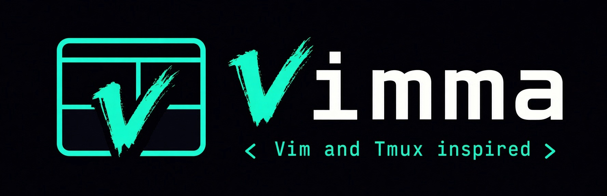

<p align="center">
  
</p>

<p align="center">
  <a href="LICENSE"></a>
  <a href="https://github.com/vimma-browser/vimma/stargazers"></a>
  <a href="https://github.com/vimma-browser/vimma/actions/workflows/ci.yml?query=branch%3Amain"></a>
  <a href="surfer.json"></a>
  <a href="https://github.com/vimma-browser/vimma/releases/latest"></a>
  <a href="https://github.com/vimma-browser/vimma/releases"></a>
</p>

# Vimma

**A keyboard-first browser for people who live in Vim and tmux.** You already have the muscle
memory; Vimma puts it to work on the web. Bare keys drive the page, `ctrl+b` drives tabs, panes
and workspaces, and your hands never leave the keyboard.

- **Vim on the page:** `j`/`k` to scroll, `f` for link hints, `/` to find, `:` for commands, and
  `Esc` to get back to normal mode. Copy a paragraph, list item or code block in three keys: `F`,
  its label, then `y` (or `v` to adjust it first).
- **tmux for the window:** `ctrl+b`, tmux's default prefix, then `c` for a new tab, `v` to split,
  `w` to switch workspace. If your fingers know tmux, they already know Vimma.
- **Every key is yours:** every binding, the prefix and the leader can be remapped in
  `config.toml`, Firefox's own keys too: every Firefox shortcut is a Vimma binding with
  Firefox's meaning, listed in `ctrl+b ?`, and `:firefox <id>` runs any other Firefox command.
- **Local AI agents, kept apart:** Claude Code, Codex, opencode and Copilot reach Vimma through
  MCP (`vimma-ctl mcp`), only in an agent workspace with its own cookies, and every request asks
  you first.

## Install

Vimma runs on Linux x86_64 and on macOS 15 or later with Apple Silicon. Download the files from the
[latest release](https://github.com/vimma-browser/vimma/releases/latest).

**Arch Linux:** run this as your normal user (not root), from any directory. It builds in
`~/.cache/vimma-build`, and the same command updates Vimma.

```sh
mkdir -p ~/.cache/vimma-build && cd ~/.cache/vimma-build && curl -fLO https://github.com/vimma-browser/vimma/releases/latest/download/PKGBUILD && makepkg -si
```

**macOS, with Homebrew:** install from Vimma's own tap; `brew upgrade --cask vimma` updates it.

```sh
brew install --cask vimma-browser/tap/vimma
```

Vimma is not yet notarised, so macOS blocks the first open ("Apple could not verify “Vimma”"):
choose **Done**, then in System Settings → Privacy & Security choose **Open Anyway** next to
Vimma. Without Homebrew, open `vimma-X.Y.Z-macos-aarch64.dmg` and drag Vimma to Applications.
The guide's [macOS](docs/guide.md#macos) section has the steps and a one-line terminal
alternative.

**Debian 12+, Ubuntu 22.04+:** download `vimma_X.Y.Z_amd64.deb`, then
`sudo apt install ./vimma_X.Y.Z_amd64.deb`.

**Any other distribution:** download `vimma-X.Y.Z-x86_64.AppImage`, then
`chmod +x vimma-X.Y.Z-x86_64.AppImage && ./vimma-X.Y.Z-x86_64.AppImage`.

`X.Y.Z` is the Vimma version. To update, install the newer release the same way. From 0.1.2 on,
the status bar says when a new release is out and `:update` shows the command for your install;
Vimma 0.1.1 does not, so update it once by hand
([Updates](docs/guide.md#updates)). The guide's [Installing](docs/guide.md#installing) section has the tarball
and how to verify a download with `sha256sum` and cosign.

## Why

The browser is the one daily tool that ignores Vim and tmux habits. Vimma brings them to a Firefox
base you can trust: sites and add-ons work as they do in Firefox, with quieter privacy defaults.
Each workspace is a container of its own, so work logins stay out of personal ones, and the
window can follow your desktop theme. [See everything it does](docs/guide.md#features-at-a-glance).

## The name

_Vimma_ is Finnish for a burst of eager, focused energy, as in _työvimma_, a spell of work where
the hours slip by. It also happens to start with _Vim_.

## Status

Early, for Linux x86_64 and macOS on Apple Silicon. Releases are on
[GitHub Releases](https://github.com/vimma-browser/vimma/releases), with a tarball, an AppImage, a
`.deb` and an Arch Linux `PKGBUILD`, and a macOS `.dmg` that also installs as a Homebrew cask
([Install](#install)); you can also
[build it from source](CONTRIBUTING.md#build-and-run). Update notices are live: Vimma 0.1.2 and
later check a signed update file every 12 hours and show a newer release in the status bar. The
AppImage, from the first release that includes its self-update, then replaces its own file with
the newer release once its size and SHA-512 match the signed file, and the next start runs it.
The other packages notify only; installing the update is up to you.

Roadmap: <https://github.com/orgs/vimma-browser/projects/1>

AI coding agents working on this repository follow [CLAUDE.md](CLAUDE.md); contributors read
[CONTRIBUTING.md](CONTRIBUTING.md) before opening issues or pull requests.
<!-- process-wording: points coding agents at their rules file -->

## Licence

[MPL-2.0](LICENSE), like Firefox; the vendored [smol-toml](https://github.com/squirrelchat/smol-toml) parser is BSD-3-Clause ([ADR-012](docs/adr/012-toml-parser-smol-toml.md)).

## Acknowledgements

[Vim](https://www.vim.org/) and [tmux](https://github.com/tmux/tmux), the models; [Firefox](https://www.mozilla.org/firefox/), underneath; [Surfer](https://github.com/zen-browser/surfer) and [Zen Browser](https://zen-browser.app/), the toolchain; [Herdr](https://herdr.dev/), the `[keys]` syntax; [Omarchy](https://omarchy.org/), the themes; [Tridactyl](https://github.com/tridactyl/tridactyl) and [Vimium](https://github.com/philc/vimium), prior art.
