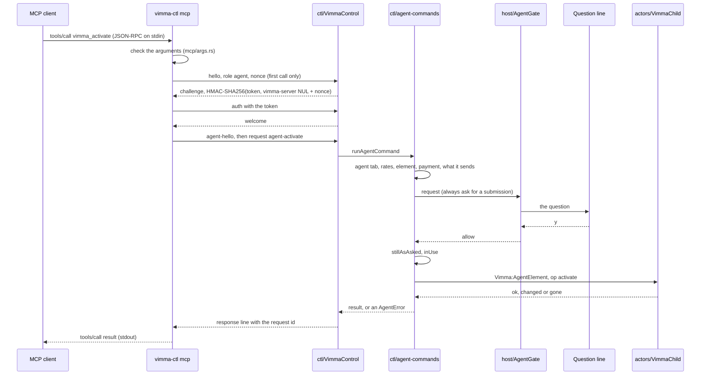

# The life of an agent call

This page follows one tool call from an AI agent host (Claude Code, Codex, or any other MCP
client) to a page in Vimma's agent workspace and back. The example is `vimma_activate`, a click on
a button that submits a form, because it passes every gate an agent call can meet; a read
(`vimma_read_page`) takes the same path with fewer stops. [ARCHITECTURE.md](../../ARCHITECTURE.md)
gives the processes and the trust boundaries; [vimma-mcp](../specs/vimma-mcp.md),
[mcp-forms](../specs/mcp-forms.md), [mcp-grants](../specs/mcp-grants.md),
[mcp-checkpoints](../specs/mcp-checkpoints.md) and [mcp-consequence](../specs/mcp-consequence.md)
give the behaviour, and [docs/security.md](../security.md) §1 (the control socket) and §12 (agents)
the rules, each with its tests. This page names the code that carries the call, in order.

## Before the call: MCP is on

The control socket is off by default. Three things start it: MCP for agents (`:mcp on`, or
`[mcp] enabled` in `config.toml`), the pref `vimma.control.enabled` for `vimma-ctl`'s own commands,
and a live ticket of an agent CLI the built-in agent runs (see the last section). With MCP on,
`ctl/VimmaControl.sys.mjs` starts its server (`startServer`) on 127.0.0.1 and a random port, makes a
256-bit token, and writes the discovery file `<profile>/vimma-control.json` through
`writeDiscovery`: created with mode 0600, written, then renamed into place, so no reader ever sees
it readable by others. `discoveryOf` puts in the protocol (2), the port, the token, the process id,
the roles served (`agent` here; `full` only with the pref `vimma.control.enabled`) and Vimma's
version. On stop the file goes before the socket (`stopServer`), so it never names a port with
nothing behind it. Tests: `test_pref_starts_and_stops_the_server` in
[browser_vimma_control.js](../../tests/browser/browser_vimma_control.js),
`test_agent_role_has_its_own_switch` in
[browser_vimma_mcp_agent.js](../../tests/browser/browser_vimma_mcp_agent.js).

## 1. The MCP client starts `vimma-ctl mcp`

The agent host runs `vimma-ctl mcp` as a stdio MCP server. `cli.rs` hands stdin and stdout to
`mcp_serve::serve`, whose loop owns all state and does every write, with one thread reading stdin
and another reading the socket. Only JSON-RPC goes to stdout; logs go to stderr.

`initialize` and `tools/list` are answered by `mcp/server.rs` alone (`Protocol::handle_line`),
with no connection to Vimma: the tool list (`mcp/tool_list.rs`) and the instructions
(`mcp/instructions.rs`) are built in. The serve loop reads the discovery file once at start, only
to say in the instructions when this `vimma-ctl` is older than the running Vimma.

## 2. The call is checked before anything leaves the process

A `tools/call` goes to `tools_call` in `mcp/server.rs`. An unknown tool or malformed params are a
JSON-RPC error; arguments that break a tool's rules (`activate_args` and its helpers in
`mcp/args.rs`: a tab id of 1 to 20 digits, a label of 1 to 3 hint characters) are a tool error the
model can correct, and never reach Vimma (`bad_arguments_never_reach_vimma` in
[tests/mcp.rs](../../tools/vimma-ctl/tests/mcp.rs)). A checked call becomes a `ToolCall`, which
`ToolCall::command` in `mcp/command.rs` turns into one control-protocol command:
`vimma_activate` becomes `agent-activate`.

`Server::start` in `mcp_serve.rs` then applies the client-side limits of `Settings`: at most 16
calls waiting at once (more fail at once as too many), at most 4 sent and unanswered per
connection (the rest are held in order), and a deadline of 390 s per call, longer than Vimma's own
longest wait so that Vimma's answer normally comes first.

## 3. The connection and the handshake

The first call opens the connection (`Server::connect`). `find` reads the discovery file through
`discovery::read_discovery`, which refuses a file with any permission bit for group or others, one
over 64 KiB, and one whose process has exited (`check_mode`, `check_pid`). `Client::connect_as` with
`Role::Agent` (`client.rs`) first checks the file: no `agent` role means "run `:mcp on`" without
connecting, and protocol 1 means the browser is too old (`check_role`).

The handshake proves the server first, so a process squatting on a stale file's port learns
nothing:

1. The client sends `hello` with protocol 2, role `agent` and a fresh 256-bit nonce
   (`protocol::hello_v2`), but no token.
2. The server (`Connection.handshake` in `VimmaControl.sys.mjs`) validates it with core's
   `validateMessage`, refuses a role that is off (`role-off`), and answers with a `challenge`:
   HMAC-SHA256 of the token over `vimma-server` NUL and the nonce (`CHALLENGE_CONTEXT` in
   `packages/vimma-core/src/control/control.mjs`).
3. The client computes the same value (`protocol::challenge_proof`, with the std-only HMAC in
   `hmac.rs`) and compares in constant time. A mismatch ends the attempt as an impostor, with the
   token unsent.
4. The client sends `auth` with the token; the server compares it with `tokensEqual`, refuses past
   8 connections or past 4 agent connections (`busy`, so agents never take every slot), and sends
   `welcome` with the role and Vimma's version.

`connect` then sends `agent-hello` with the client's self-reported name and version, the parent
process's name as `via` (`parent_name`: `/proc` on Linux, `/bin/ps` on macOS; it stands in for the
client name only when the client gave none), `vimma-ctl`'s version and a session id unique
to this process. These are labels for the question, never proof of identity. In the browser,
`COMMANDS["agent-hello"]` in `ctl/agent-commands.mjs` registers the connection with
`AgentGate.connect` and answers with the agent workspace's name.

Tests: `test_handshake` in [browser_vimma_control.js](../../tests/browser/browser_vimma_control.js);
`the_token_never_leaves_the_handshake`, `role_off_at_the_hello_says_mcp_is_off` and
`mcp_off_says_to_run_mcp_on_without_connecting` in
[tests/mcp.rs](../../tools/vimma-ctl/tests/mcp.rs); `refuses_a_file_others_can_read` in
`discovery.rs`; `test_agents_cannot_take_every_connection` in
[browser_vimma_mcp_agent.js](../../tests/browser/browser_vimma_mcp_agent.js). The rules are S1 to
S14 in security.md §1.

## 4. The request reaches the agent commands

The request line goes out with an id (`Server::send`). On the server, `Connection.request` lets a
connection run only its role's commands: an agent connection asking for `send-keys` or `state` gets
`unknown-command`, and a full one gets the same for any agent command
(`test_each_role_runs_only_its_commands`). `agentRequest` validates the arguments again, refuses a
fifth request in flight (an `agent-cancel` is not counted) as `denied` with reason `busy`, and calls
`runAgentCommand`, which requires `agent-hello` first and raises the named tab to foreground
priority until the reply.

`COMMANDS["agent-activate"]` then decides everything it can before the user is asked:

- `agentWorkspace` fails when there is no agent workspace (containers off); `findAgentTab` answers
  `invalid-args` for any tab outside it, in the same words whether the tab is in another
  workspace, another window or another conversation's, so nothing leaks (M2).
- The click rate is taken first (`actCalls`, a `CallRate` of core `agent.mjs`), before anything
  else is learnt, so a refused call cannot loop; a used-up rate is `denied` with `busy` and a
  retry time (M32).
- `inUse` refuses a tab the user is working in (`in-use`). `AgentDrive.element` resolves the label
  from this connection's last `vimma_elements` list, and `AgentAct.clickable` checks the element
  in its frame: fields, file inputs, disabled controls and links to another site are refused
  here, before any question (M29).
- The open rate (`opens`, an `OpenRate`) is only checked here, since a click may load a page; it
  is taken after the click, and only when the click navigated (M3).
- `AgentAct.payment` and `AgentAct.sent` read whether the click may pay and what a submission
  would send. Core's `isConsequential`, `mayAllowHere` and `allowanceKey`
  (`packages/vimma-core/src/agent/agent-checkpoint.mjs`) decide whether a grant covers the form, and
  whether `a` may allow that button on that site.

Every refusal outside the gate is written to `:mcp log` through `AgentGate.note` (M23).

## 5. The gate and the question

`ask` in `agent-commands.mjs` calls `AgentGate.request` with the tool name, a plain-data
description of what the call touches, and `always` set for a submission or a payment. The gate
(`host/AgentGate.sys.mjs`) puts the rules in core's `AgentQueue`
(`packages/vimma-core/src/agent/agent.mjs`) and adds the clock:

- `queue.ask` answers `run` when the connection's grant covers the call: it runs at once, with a
  notice and a log row. A harmless form is covered (`covered`); one that sends text, personal
  details, a secret or a file is covered only by an allowance an earlier `a` made for that button
  on that site; a payment never is.
- It answers `deny` for a full queue (`busy`) or a connection muted after repeated denials.
- Otherwise the question waits, with a timer of `[mcp] ask_timeout` (50 s by default, 10 to
  300). Listeners hear an `asked` event: `host/agent-ui.mjs` draws the question line
  (`ui/agent-prompt.mjs`) or the status bar's `◇ agent 1?`, and passes the user's key to
  `AgentGate.answer`.

`answer` turns the key into the outcome: on a checkpoint a grant key allows that step once and
makes no grant, and `a` makes an allowance for that button on that site for the rest of the grant.
`settle` logs the call and resolves the waiting promise; a grant can release other waiting calls
of the same connection, which run under it. A no, a timeout or a closed connection reach the
command as an `AgentError` with code `denied` and a reason (`user`, `timeout`, `busy`, `muted`,
`cancelled`). Tests: [agent-gate.test.mjs](../../packages/vimma-core/test/agent-gate.test.mjs),
[agent-checkpoint.test.mjs](../../packages/vimma-core/test/agent-checkpoint.test.mjs),
`test_denials_timeouts_queue_and_mute` and `test_one_grant_covers_every_tool_of_its_connection` in
[browser_vimma_mcp_agent.js](../../tests/browser/browser_vimma_mcp_agent.js),
`test_submit_asks_under_a_grant` in
[browser_vimma_mcp_submit.js](../../tests/browser/browser_vimma_mcp_submit.js), and
`test_a_allows_that_button_on_that_site` in
[browser_vimma_mcp_checkpoint.js](../../tests/browser/browser_vimma_mcp_checkpoint.js).

## 6. After the yes: the page

A yes stands only for what was asked. `stillAsAsked` refuses with reason `changed` when the agent
workspace was replaced, the tab left it, or the tab's URL differs from the one in the question
(M8, `test_the_yes_stands_for_what_was_asked`); `inUse` is checked once more.

`AgentAct.activate`, wrapped in `AgentShot.acting`, marks the page so that a form submission the
page's own script starts after the click is cancelled unless it is the one asked about
(`VimmaActors.agentMark`), then calls `VimmaActors.agentActivate`
(`actors/VimmaActors.sys.mjs`). That sends `Vimma:AgentElement` with `op: "activate"` to the
frame's `VimmaChild`, which looks the element up by the list's generation and id. Its
`#agentActivate` answers `gone` for an element no longer on the page or a request past its time,
`changed` for one that no longer submits to the method and address the question named, and
otherwise `ok`, then clicks with the element's own `click()`, never synthesised input, so the page
gets no user activation (M26). Tests:
[browser_vimma_mcp_activate.js](../../tests/browser/browser_vimma_mcp_activate.js),
`test_a_submit_sent_elsewhere_than_asked_is_stopped` in
[browser_vimma_mcp_submit.js](../../tests/browser/browser_vimma_mcp_submit.js).

A read takes a different last step: `COMMANDS["agent-read"]` loads a lazy tab, reads the text
through Firefox's own `PageExtractor` actor and the selection through `VimmaActors.selection`,
checks `stillAsAsked` again after everything is collected, and wraps page text in the
untrusted-content delimiters (`wrapUntrusted` in core `agent.mjs`, M7, M8).

## 7. The way back

The command's return value goes back through `agentRequest` as `{ result }` on the response line
with the request's id; an `AgentError` becomes `{ error: { code, message, reason, retryAfter } }`,
and any other exception a bare `internal` error. A reply must fit the protocol's 1 MiB line
(`MAX_LINE_LENGTH`).

In `vimma-ctl`, the socket's reader thread hands the line to `Server::on_vimma`, which decodes it
(`protocol::decode_response`), matches it to the waiting call by id and writes the MCP response
with `mcp::tool_result` (`mcp/render.rs`): a result becomes text for the model, an error a tool
error whose words `failure_text` chooses (decision 5 of vimma-mcp). A malformed response closes
the connection and fails every waiting call, since nothing more on it can be trusted.

Three other ends:

- **Cancelled.** MCP's `notifications/cancelled` makes `Server::cancel` send `agent-cancel`, which
  withdraws only that connection's question
  (`a_cancelled_call_withdraws_its_question_and_gets_no_response`,
  `test_agent_cancel_withdraws_one_waiting_question`).
- **Out of time.** `Server::tick` fails a call past its deadline and withdraws its question the
  same way.
- **Dropped.** A closed connection fails the waiting calls; the next call connects again, and
  with the same session id gets back the grant the dropped link held
  ([mcp-session-grants](../specs/mcp-session-grants.md);
  `a_dropped_connection_fails_the_waiting_call_and_the_next_call_reconnects`,
  `test_a_reconnect_of_the_same_session_keeps_its_grant`). An `agent-ping` every 30 s keeps an
  idle connection from Vimma's 60 s idle limit.

## Where the built-in agent joins

The built-in agent ([builtin-agent](../specs/builtin-agent.md),
[ADR-023](../adr/023-in-browser-model-client.md)) has no socket: it skips steps 1 to 3 and
`agentRequest`. Each conversation in `agent/AgentChat.sys.mjs` is one gate connection,
`builtin:<n>`, opened with `builtinHello`; its model's tool calls go through `runOnce`, which calls
`runAgentCommand` directly in the browser process. From there the path is the same code: the same
checks, gate, log and actors. Sending a task with Enter grants that connection through
`AgentGate.grantConnection` until the task ends, with no question; submissions that M28 makes ask,
payment steps, `vimma_show` and the downloads that always ask still ask under it (M37), and an MCP
client cannot pass as the built-in agent: `mcpClientName` adds ` (mcp)` to any client name that
starts with `built-in` (M38). Test: `test_enter_grants_and_the_transcript_shows_each_step` in
[browser_vimma_agent_chat.js](../../tests/browser/browser_vimma_agent_chat.js).

An agent CLI that the built-in agent runs ([builtin-agent-cli](../specs/builtin-agent-cli.md))
comes back in through steps 1 to 3 with a one-time ticket instead of the token:

1. `agent/AgentCli.sys.mjs` asks `VimmaControl.issueTicket` for a ticket bound to the
   conversation's connection; the server listens for it even with MCP off, and writes no
   discovery file for it.
2. The ticket and port reach the CLI's `vimma-ctl mcp` only in the environment of the MCP
   configuration Vimma writes (`VIMMA_AGENT_TICKET`, `VIMMA_AGENT_PORT`, in core
   `agent-cli.mjs`), never on a command line. `Env::from_process` and `AgentTicket::discovery` in
   `discovery.rs` read them; the discovery file is then never read.
3. The hello names the ticket only by its id, HMAC-SHA256 of the ticket over `vimma-ticket` NUL;
   the server proves it knows the ticket before the client sends it.
4. `Connection.ticketCommand` runs each command as the conversation (`runAgentCommand` with the
   ticket's connection and state), counts it against the run's step budget, and ends with the
   ticket when the task stops (`revokeTicket`).

Tests: `mcp_connects_with_a_ticket_from_the_environment` and
`a_ticket_handshake_proves_the_server_first` in
[tests/mcp.rs](../../tools/vimma-ctl/tests/mcp.rs), and
[browser_vimma_agent_cli_run.js](../../tests/browser/browser_vimma_agent_cli_run.js). The rules are
M35 to M61 in security.md §12.
