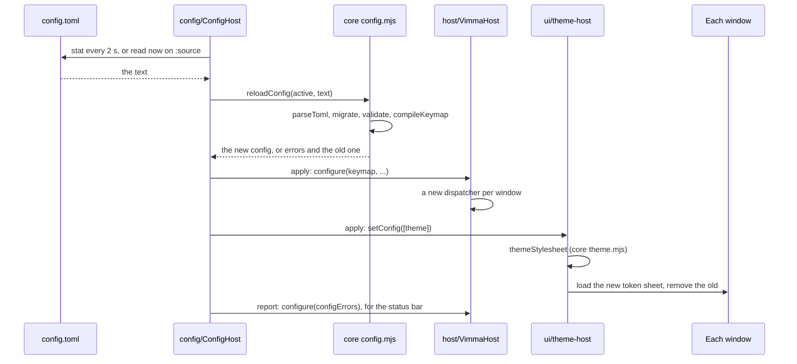

# Config and theme: from a file on disk to the window

This page follows two files into the running browser. The first is `config.toml`: an edit is
picked up by a poll or by `:source`, parsed and checked in vimma-core, and handed whole to the
modules that use it, the keymap among them. The second is the theme: the built-in palette, or an
Omarchy `colors.toml`, becomes one stylesheet of CSS custom properties in every window.
[ARCHITECTURE.md](../../ARCHITECTURE.md) gives the folders and the state table; the behaviour is
in [m5-config-load](../specs/m5-config-load.md),
[m5-core-config-and-theme](../specs/m5-core-config-and-theme.md),
[m5-omarchy-theme](../specs/m5-omarchy-theme.md), [theme-appearance](../specs/theme-appearance.md)
and [content-color-scheme](../specs/content-color-scheme.md), the decisions in
[ADR-008](../adr/008-config-toml.md) (one `config.toml`) and
[ADR-012](../adr/012-toml-parser-smol-toml.md) (the TOML parser), the rules with their tests in
[docs/security/](../security/README.md) §7 (the Omarchy hook) and §8 (`config.toml`), and how
Omarchy
keeps its theme in [docs/notes/omarchy-theming.md](../notes/omarchy-theming.md). What each key
of the file means is in [docs/guide.md, "config.toml"](../guide.md#configtoml).

## 1. Finding and reading `config.toml`

`config/ConfigHost.sys.mjs` is one module for the app. `vimma.js` calls `ConfigHost.init` for each
window, after `VimmaHost` and `PaneViews` exist; the first window starts it. Until the first read
the windows run on the built-in keymap, and the read never blocks startup. The file is the one the
pref `vimma.config.path` names, else `$XDG_CONFIG_HOME/vimma/config.toml` when that variable is an
absolute path, else `~/.config/vimma/config.toml` (`configPath`).

`start` does, in order: observe the two prefs and the `:source` and `:config` topics, arm the
poll timer, create a missing file from the commented template on a profile's first run (mode
0600 in a 0700 folder, never over an existing file; `firstRun`), and read the file at once
(`poll(true)`). The poll is a one-shot timer armed again at each tick, every 2 s by default
(`vimma.config.pollMs`), because Firefox has no portable file watcher. Each tick runs `check`:

1. `stat` takes the file's modification time and size, or "missing". A tick that finds the same
   signature as the last read stops here; otherwise the new signature is kept before the read.
2. The file is read. A missing file is the empty text, so the defaults apply. A file that cannot
   be read holds update checks off and logs the error, and the config in force stays; since the
   signature was already kept, it is tried again only once its time or size changes, or on
   `:source`.
3. `use` hands the text to core and applies the result (sections 2 and 3).

One read runs at a time; a forced read asked for during one runs after it.

`:source` is the action `config.reload`, whose runner in `host/runners.mjs` notifies
`CONFIG_RELOAD_TOPIC`, which `ConfigHost` observes, so the host never imports it.
`ConfigHost.reload` without an argument reads `config.toml` now, changed or not. With a path,
`source` reads that file instead and puts it in force the same way; there a missing file is an
error, since the user named it. A sourced file stays in force until `config.toml` changes or a
plain `:source`. Tests: `a_remapped_key_applies_after_the_poll`, `colon_source_reloads_at_once`,
`colon_source_a_path_replaces_the_config_and_reports_that_file` and
`the_poll_is_not_a_repeating_timer_a_test_could_be_blamed_for` in
[browser_vimma_config.js](../../tests/browser/browser_vimma_config.js);
[browser_vimma_config_first_run.js](../../tests/browser/browser_vimma_config_first_run.js); F1
in security.md §8.

## 2. Parsing and checking in vimma-core

`reloadConfig(active, text)` in `packages/vimma-core/src/config/config.mjs` calls `parseConfig`,
which does no I/O. A TOML or schema error ends it at once; validation and the keymap report their
problems together:

1. **TOML.** `parseToml` (`toml.mjs`) runs the vendored smol-toml
   (`packages/vimma-core/src/vendor/smol-toml/`, ADR-012) with integers as BigInt, so `1.0` can be
   told from `1`. A syntax error becomes one error with its line and column, and a hint when an
   earlier bracket is still open. Nesting deeper than `MAX_DEPTH` (32 at present) is refused, since
   smol-toml bounds only inline values.
2. **Schema.** `schema` must be a non-negative integer; a number above `CONFIG_SCHEMA_VERSION`
   (2 at present) is "from a newer vimma", and nothing of the file applies.
3. **Migration.** `migrate` runs the steps of `MIGRATIONS` from the file's schema up: a file
   without `schema` is schema 0. Each step is pure, and schema 2 only adds keys, so an older
   Vimma reading a newer file names the schema rather than an unknown key (ADR-008).
4. **Validation.** `validate` checks every table and value and collects every problem, with a
   suggestion for a misspelt key or action. Values that would reach a page or run something are
   refused here: a `javascript:` home page, a program path or a secret in `[agent]`.
5. **Keymap.** When the keymap sections (`[keys]`, `[modal]`, `[unbind]`, `[firefox]`) have no
   problem of their own, `compileKeymap` builds the tries ([The life of a keypress](keypress.md));
   a `KeymapError` becomes one more problem, worded with the name the user wrote.

With any problem the result has no config, and each problem is located with `locateKeys` and
sorted by line. Otherwise `mergeWithDefaults` gives the resolved config, which keeps the file's
order of `[workspaces]` and `[sites]`. `reloadConfig` then returns either the new config and
keymap, or the one in force with the errors: the previous config, or the defaults when there was
none (`kept: true`). Tests: [config.test.mjs](../../packages/vimma-core/test/config.test.mjs),
[config-v2.test.mjs](../../packages/vimma-core/test/config-v2.test.mjs),
[toml.test.mjs](../../packages/vimma-core/test/toml.test.mjs) and
[toml-conformance.test.mjs](../../packages/vimma-core/test/toml-conformance.test.mjs); the
fixtures of each schema in `tests/contract/config/v<n>/` (a valid file, invalid ones and their
expected errors), read by
[contract.test.mjs](../../packages/vimma-core/test/contract.test.mjs); and the fast-check
properties in [config.fuzz.test.mjs](../../packages/vimma-core/test/fuzz/config.fuzz.test.mjs).

## 3. Applying it, or keeping the last good one

Back in `ConfigHost`, `use` applies the result only when it is a new config (`apply`). A file
with errors therefore changes nothing in force, except on the first read, when the defaults it
falls back to are applied as a file would be. That is not a no-op: among other things it hands
`WorkspaceStore` the default, empty `[workspaces]`, whose reconcile keeps the workspaces the
definitions file has but no longer as config ones, and saves them. `apply` hands each part to
its owner:

- `VimmaHost.configure` with the keymap, the hint characters, `[sites]`, `[firefox]`,
  `[modal] insert_editing` and the bookmarks root. For a new keymap each window drops its pending
  sequence, gets a new dispatcher and a rebuilt help overlay, and turns off Firefox's shortcuts on
  the chords the keymap binds.
- Each window's `PaneView` takes `[panes]`; `ThemeHost.setConfig` takes `[theme]` (section 4);
  `WorkspaceRouter` the `[[routes]]` and `[routing]`; `McpHost` `[mcp]` and `[agent]`; and the
  toolbar, the bookmarks toolbar, the PDF outline (`[ui] pdf_outline`), the private swap's
  placement and the side panel's numbers their own lines.
- `SearchHost.setConfig` and `WorkspaceStore.setConfig` run asynchronously; `[search]` can
  reveal problems only once the profile's engines are read, and adds them to the errors later.

Then, whether or not the file applied, `use` tells the update check what `[updates] check` now
is (`updatesCheckAfterRead` in core `updates.mjs`). A file with errors still decides it when its
TOML parses: its own `check` applies, and a missing one counts as true, so a value from a newer
build never keeps the user from the release that accepts it. Only when `check` cannot be read
(the TOML does not parse, or the line is malformed or misplaced) does it keep the value of the
config in force, and when only the defaults stand in for the file, at startup, it holds checks
(`:update` aside). `use` then
calls `report`, which logs the errors (once per change of the file, and again on each `:source`)
and passes them to `VimmaHost.configure` as `configErrors` with the file's
name. The status bar shows them, `about:vimma` lists them, and the built-in agent's window names
a refused file when it has no model. A provider whose agent CLI this build does not know is left
out with a warning, and the rest of the file applies. Tests:
`a_broken_line_keeps_the_old_config_and_shows_file_and_line` and
`an_unknown_agent_cli_skips_its_provider_and_the_file_applies` in
[browser_vimma_config.js](../../tests/browser/browser_vimma_config.js); F2 and F3 in
security.md §8.

## 4. The theme tokens

`ui/theme-host.mjs` (`ThemeHost`) is also one module for the app. `vimma.js` calls
`ThemeHost.init` for each window before the host starts, and it loads the current token sheet as
an author sheet (a `data:` URI) together with Vimma's sheets for Firefox's surfaces. The first
window starts it: it observes the theme prefs and looks once for Omarchy (`lookForOmarchy`:
`~/.local/share/omarchy` or `~/.local/state/omarchy`).

The theme follows Omarchy when it is not forced to the built-in palette (the pref
`vimma.theme.source` set to `builtin`, or `[theme] source = "file"`) and either Omarchy was found
or `vimma.theme.omarchyPath` is set by hand. `check` then:

1. `stat`s `colors.toml` and `light.mode` in the theme folder (by default
   `~/.local/state/omarchy/current/theme`). A missing `colors.toml` gives the built-in palette
   when nothing is shown yet, and otherwise keeps the theme shown, since `omarchy-theme-set`
   removes the old folder just before it moves the new one in. The signature holds the folder,
   the file's modification and creation times, its size and whether `light.mode` exists, and
   `IOUtils.stat` follows symlinks, so a swap of the `current/theme` link to another theme
   changes it even when the two files have the same time and size.
2. An unchanged signature stops here; otherwise the file is read.
3. `themeStylesheet` (`packages/vimma-core/src/config/theme.mjs`) builds the sheet. `resolveTheme`
   reads the file with `parseOmarchyColors` (hex colours only, missing keys derived as Omarchy
   derives them), lays `[theme.colors]` over it, maps the palette to the `--vimma-*` tokens, and
   warns about text below 4.5:1 contrast. `tokensToCss` accepts only values `resolveTheme` can make
   (a `#rrggbb` colour, a colour-scheme word, a checked font list) and throws on anything else, so
   a theme file cannot inject CSS.
4. A file with errors is rejected: the theme shown stays, and the error is kept for
   `about:vimma`. Otherwise `apply` loads the new sheet in every window, then removes the old one
   (so no frame is drawn without tokens), does the same for Firefox's own themed pages, and
   rewrites the `<style>` of Vimma's own pages (the start page, `about:vimma`, the setup page).

The poll runs every `vimma.theme.pollMs` (2 s by default) only while a window is open and there is
an Omarchy theme to follow. Like the config poll, it is a one-shot timer armed again at each tick,
so the test harness never blames a repeating timer on another test file. Without Omarchy the
built-in palette, `[theme] name`, applies and nothing is polled. Vimma's CSS in
`src/browser/themes/shared/vimma/` is written against the tokens, so the surfaces it styles change
with the sheet. Tests:
[theme.test.mjs](../../packages/vimma-core/test/theme.test.mjs), the sample themes in
`tests/contract/theme/`,
[theme.fuzz.test.mjs](../../packages/vimma-core/test/fuzz/theme.fuzz.test.mjs);
`rewriting_the_file_updates_within_the_poll`, `broken_file_keeps_the_previous_colours` and
`swapping_the_symlink_follows_the_new_theme` and
`the_poll_is_not_a_repeating_timer_a_test_could_be_blamed_for` in
[browser_vimma_theme.js](../../tests/browser/browser_vimma_theme.js);
`without_omarchy_nothing_polls_and_the_builtin_shows` in
[browser_vimma_theme_appearance.js](../../tests/browser/browser_vimma_theme_appearance.js).

## 5. Light, dark and web pages

The built-in `vimma` palette has a light variant. When nothing pins its appearance,
`themeStylesheet` writes the dark tokens and then the light ones under
`@media (prefers-color-scheme: light)`, so the windows switch with the system's colour scheme
with no script. `[theme] appearance` pins it; without that line, `:theme` sets the pref
`vimma.theme.appearance` (`ThemeHost.setAppearance`); `[theme.colors] mode` wins over both. An
Omarchy theme has one mode, from its `mode` key, a `light.mode` file, or the brightness of its
background.

A theme with a fixed mode also sets `--vimma-content-color-scheme`. A rule in
`src/browser/themes/shared/vimma/firefox-chrome.css` gives each tab's `<browser>` that colour
scheme, so pages that follow `prefers-color-scheme` match the browser. It applies only while
Firefox's "Website appearance" setting is Automatic and forced colours are off; a theme that
follows the system leaves the token unset, and Firefox's own choice stands. Tests:
`builtin_vimma_follows_the_colour_scheme_live` in
[browser_vimma_theme.js](../../tests/browser/browser_vimma_theme.js);
`theme_switches_the_builtin_palette_live_and_keeps_it` and `config_toml_wins_over_theme` in
[browser_vimma_theme_appearance.js](../../tests/browser/browser_vimma_theme_appearance.js);
[browser_vimma_content_color_scheme.js](../../tests/browser/browser_vimma_content_color_scheme.js),
among them `firefox_website_appearance_wins`.

## 6. The Omarchy hook: a reload without waiting for the poll

`omarchy/OmarchyHook.sys.mjs` registers, once per process, a command-line handler for
`-vimma-reload-theme`. A line that carries the flag from another process calls `ThemeHost.reload`,
which waits for a running check, forgets the signature and checks again. On a first launch the
handler drops the flag, and the launch opens its window as usual. When `ThemeHost` has found
Omarchy, `~/.config/omarchy/hooks` exists, the browser is not under automation or in permanent
private browsing (`startupBlocked`), and the pref `vimma.theme.omarchyHook` is on (the default),
`sync` writes `omarchy/vimma-theme-reload.sh` into `~/.config/omarchy/hooks/theme-set.d/`, with a
last line holding its SHA-256, and keeps it current while that hash still matches. An edited copy is
the user's and is never touched; a copy the user deleted is not written again; turning the pref off
removes Vimma's unedited copy.

`omarchy-theme-set` runs the hook after it has switched the theme. The script sends the flag to
every running Vimma through Firefox's own command-line remoting, the D-Bus `OpenURL` call a second
`vimma <args>` makes (`busctl`), so it never starts a browser; without D-Bus it falls back to
`vimma-ctl reload-theme`, which needs the control socket on. Tests: `test_remote_reload_theme`
and `test_installer` in
[browser_vimma_omarchy_hook.js](../../tests/browser/browser_vimma_omarchy_hook.js);
[theme-hook.test.ts](../../tools/omarchy/test/theme-hook.test.ts), which runs the script with
fake `busctl`, `vimma-ctl` and `vimma`; `test_reload_theme` in
[browser_vimma_control.js](../../tests/browser/browser_vimma_control.js); and security.md §7.
