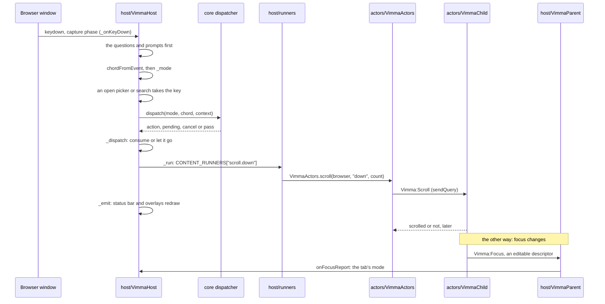

# The life of a keypress

This page follows one key from the keyboard to what it does. The example is `j` in normal mode on a
web page, which scrolls it down: it passes most of the stages a key can meet, from the window's
capture listener through vimma-core's dispatcher and the host's runner tables to the page's own
frame. [ARCHITECTURE.md](../../ARCHITECTURE.md), "How a key is handled", gives the five-line
summary; [m0-key-capture](../specs/m0-key-capture.md),
[m0-core-dispatcher](../specs/m0-core-dispatcher.md), [firefox-keys](../specs/firefox-keys.md),
[m1-actor-insert-scroll](../specs/m1-actor-insert-scroll.md) and
[insert-focus](../specs/insert-focus.md) give the behaviour,
[ADR-009](../adr/009-flush-only-ambiguous.md) and [ADR-024](../adr/024-keymap-contexts.md) the
decisions, and [docs/security.md](../security.md) §13 (page modes) the rules with their tests. This
page names the code that carries the key, in order.

## Before the key: the keymap

`VimmaHost.init` gives each window a dispatcher over the keymap in force (`settings.keymap`), or
over the built-in one (`compileKeymap({})`) while `config.toml` has not been read yet;
`VimmaHost.configure` replaces every window's when `ConfigHost` applies the file
([Config and theme](config-and-theme.md)). `compileKeymap` in
`packages/vimma-core/src/keys/keymap.mjs` builds the keymap in this order:

- `[keys]`: one entry per action, a list of key sequences that replaces the default list. A
  sequence that starts with the prefix (`ctrl+b` by default), or with a chord that holds ctrl,
  alt or meta, or with a function key, binds in every mode; one that starts with the leader binds
  in normal mode, the side panel and the PDF context; any other binds in normal mode and the PDF
  context.
- `[modal.<mode>]`: bindings for one mode, merged over the defaults per sequence, which shadow a
  `[keys]` binding of the same sequence in that mode. Normal mode's apply in the `pdf` context
  too, and `[modal.pdf]` is merged over them there (ADR-024). A value that starts with `:` is a
  command line, compiled to the action `cmdline.run` with that `line`.
- `[modal] insert_editing` (on by default) leaves Vim's text-field chords to the field in the
  modes that type, unless the user bound the chord.
- `[unbind]` takes sequences out of a mode, then `[firefox] enable` gives a chord back to
  Firefox in every mode.

It then builds one trie of chords per mode and one for the `pdf` context, and throws a
`KeymapError` with the config path for a sequence bound twice in one mode. The modes are listed in
`modes.mjs`; the prefix is not one of them, since the dispatcher tracks a pending prefix itself.
Tests: [keymap.test.mjs](../../packages/vimma-core/test/keymap.test.mjs) and
[keymap-contexts.test.mjs](../../packages/vimma-core/test/keymap-contexts.test.mjs).

## 1. The window hears the key first

`VimmaHost.init` adds `state.onKeyDown` as a `keydown` listener on the browser window in the
capture phase, so the key reaches Vimma before the address bar, Firefox's own pages, the PDF
viewer and the page in the content process. `_onKeyDown` then lets other owners take it, in this
order, and returns when one does:

1. A key the page already had and Firefox sent back for chrome's shortcuts
   (`isReplyEventFromRemoteContent`), and an Enter or arrow key Vimma pressed itself
   (`pressingKey`, `actors/enter-key.mjs`), are not looked at again.
2. The agent question (`AgentUi.onKey`), the security update question (`UpdateUi.onKey`), an open
   permission prompt (`state.promptKeys`), and the built-in agent's window while no sequence is
   pending (`state.agentChat.onKey`).
3. `chordFromEvent` (`packages/vimma-core/src/keys/keys.mjs`) turns the event into a chord, or null
   for a bare modifier. Shift is folded into printable characters other than letters (`?`, not
   `shift+/`), and a character typed with AltGr or Option is that character without alt.
   `formatKey` gives the canonical text the tries are keyed by.
4. Hints and element focus end when focus has left their page; the setup page keeps its plain
   keys.
5. `_mode(state)` decides the mode: `help` while an overlay or picker is open, `command` with the
   command line, `insert` while a rename or y/N prompt types, `panel`, `resize`, `index`, `hint` or
   `element` while those are active, then the focused tab's own mode (`browserModes`, normal until a
   focus report or a key changes it), and `insert` when focus is in the browser's chrome or in a
   page without Vimma's actor, so the address bar keeps its keys.
6. The key goes into `_lastChords`, a list the mochitests read (never in a private window or a
   password field). An open picker then takes every key, a `/` search its Enter and Esc, and the
   help filter its plain keys.

Tests: `records_ctrl_b_in_about_preferences`, `records_ctrl_b_in_url_bar` and
`records_an_unbound_key_in_content_and_page_still_receives_it` in
[browser_vimma_key_capture.js](../../tests/browser/browser_vimma_key_capture.js), which read
`_lastChords`; [keys.test.mjs](../../packages/vimma-core/test/keys.test.mjs) for the notation.

## 2. The dispatcher answers

`_dispatch` clears any pending timer, asks `PdfOps.context` for the keymap context of the
selected tab (`pdf` in Firefox's PDF viewer, `page` elsewhere), and calls
`state.dispatcher.dispatch(mode, chord, context)` (`createDispatcher` in
`packages/vimma-core/src/keys/dispatcher.mjs`). The dispatcher holds only a pending buffer: the trie
node reached so far, the labels for the status bar, a count, and an action waiting for its
character (`f` then `x`). A change of mode or context drops the buffer, so a sequence started
under one set of bindings never finishes under another. For each key it answers one of four
results:

- **`action`**: a leaf of the trie, with its count, its `arg`, its typed `char` or its `line`.
  When the key ends an ambiguous sequence without continuing it (`g` bound, then a key that
  does not follow `g`), the shorter binding comes back with `replay: true`, and the host runs it
  and dispatches the same key again.
- **`pending`**: a node with children, an action that waits for its character (`f`), or a digit
  in a mode that takes counts (`COUNT_MODES` in `modes.mjs`: normal, visual, element, resize and
  panel). A `0` starts no count, and a digit bound at the root is that binding.
- **`cancel`**: Esc during a sequence, or a key that leads nowhere after a prefix or a count.
- **`pass`**: nothing is pending and the key is not in the trie.

Tests: [dispatcher.test.mjs](../../packages/vimma-core/test/dispatcher.test.mjs), for example
"an ambiguous sequence followed by a non-continuing key runs the shorter and asks for replay" and
"a count followed by an unbound key cancels".

## 3. The host acts on the answer

`_dispatch` first logs the key and its result for `about:vimma` (`KeyLog.record` in
`host/key-log.mjs`): never in a private window, and a plain key typed in insert or command mode
is kept only as `·`. Then it handles each kind:

- **`pass`.** The key goes on to Firefox and the page. Before that, `_editKey` looks for a
  text-field command for an unbound chord (`ctrl+w`, `ctrl+u`, `ctrl+h`, `host/edit-keys.mjs`): in a
  chrome field it runs at once and the key is consumed; in a page's field, in insert mode, the key
  goes on and the command runs after the page had it, unless the page took the key
  (`_onKeyDownAfter`). Otherwise, in the modal modes (`help`, `hint`, `resize`, `panel`, `index`)
  the key is consumed; a chord Firefox handles outside its keysets is prevented when the config
  leaves it off (`CHROME_HANDLED`); and in `visual` and `element` mode a plain key is consumed.
- **`cancel`.** The key is consumed: `preventDefault` and `stopPropagation` (`consume`).
- **`pending`.** The first key of a sequence that leads to nothing runnable now passes after all
  (`_leadsToRunnable`): `ctrl+w` reaches the page when the window has one pane
  (`ctrl_w_in_normal_mode_with_one_pane_passes_to_the_page`). Otherwise the key is consumed and,
  only when `dispatcher.ambiguous()` says the buffer is itself a complete binding, a timer of
  `[modal] timeout_ms` (800 ms by default) calls `dispatcher.flush()`, which resolves it to the
  shorter binding (ADR-009). A bare prefix never times out; it waits for the next key or Esc.
- **`action`.** A first key whose action cannot run now (`_runnable`: a pane action with one
  pane, a page action with no page focused) passes. A page-first chord does not run yet: see
  the next section. Otherwise the key is consumed and `_run` runs the action.

Tests: `g_as_the_first_key_of_gg_is_consumed` and `j_and_k_scroll_and_the_page_sees_neither` in
[browser_vimma_insert_scroll.js](../../tests/browser/browser_vimma_insert_scroll.js).

## 4. Page-first keys

Some chords Firefox lets a page override, and Vimma does the same
([firefox-keys](../specs/firefox-keys.md), decision 6): `pageFirst` in
`packages/vimma-core/src/keys/firefox-keys.mjs` says which, by Firefox's inventory, the mode, full
screen and the fullscreen Keyboard Lock. `_pageFirst` makes the key Vimma's first after all when
the site's "Override keyboard shortcuts" permission is Block, or when `[firefox] enable` keeps
the chord for Firefox.
`_pageFirstAction` adds the suggestion keys (`ctrl+n`, `ctrl+p`) while a page has focus.

For such a chord `_dispatch` stores the result in `state.pageFirst` (a `PageFirstQueue` of core
`page-first.mjs`) and lets the keydown go on. The keypress listener in the system group's capture
phase (`_onKeyPress`) stops the event when it goes to a remote page and asks for the page's reply
(`requestReplyFromRemoteContent`). When the reply comes back, `_pageTookKey` checks whether the page
called `preventDefault` (in insert mode a native handler in the content process counts too); if
not, `_runAfterPage` runs the stored action. A chrome field or a
parent-process page settles the key in `_onKeyPressAfter`, in the bubble phase. Tests:
`ctrl_m_mutes_unless_the_page_takes_it`, `a_blocked_shortcuts_permission_makes_the_key_vimmas_first`
and `a_page_first_key_runs_in_a_tab_whose_process_is_still_starting` in
[browser_vimma_browser_keys.js](../../tests/browser/browser_vimma_browser_keys.js);
[page-first.test.mjs](../../packages/vimma-core/test/page-first.test.mjs).

## 5. The runner

`_run` refuses an id outside `RUNNABLE` with a notice, then looks in two tables that
`host/runners.mjs` builds and `VimmaHost.sys.mjs` exports as `RUNNERS` and `CONTENT_RUNNERS`:

- `contentRunners(host, page)` holds the actions on the focused page: scrolls, history, reload,
  hints, insert, find, element focus, and the copy mode, page and PDF runners spread in from
  `host/copy-mode.mjs`, `host/page-ops.mjs` and `host/pdf-ops.mjs`. `_run` hands one the focused
  `<browser>` when it has Vimma's actor (`_contentBrowser`), or for a few actions
  (`ON_SELECTED`) the selected tab's.
- `hostRunners(host, page)` holds the actions on the window, each called with the window's state,
  the action and any command-line text: tabs, panes, workspaces, pickers, the side panel, help,
  the command line and the rest, through the `host/*-ops.mjs` modules (`tab-ops.mjs`,
  `pane-ops.mjs`, `workspace-ops.mjs` and others).

The host is passed into both builders, never imported by `runners.mjs`, so that module and the
ops modules load without an import cycle. `j` is `scroll.down`, whose runner calls
`VimmaActors.scroll(browser, "down", count)`.

## 6. The page

`VimmaActors.register` (called once per process from `vimma.js`, before `VimmaHost.init`) registers
the JSWindowActor pair: `VimmaChild` in every frame (`allFrames`) of http, https, file, about and
view-source documents and the start page, `VimmaParent` in the parent (`host/VimmaParent.sys.mjs`,
whose URL `vimma.js` passes in: `actors/` names no `host/` module), marked
`safeForUntrustedWebProcess` because the parent trusts nothing from the child but a descriptor,
which at worst flips that tab's mode, and checks every other reply. `VimmaActors.scroll` sends
`Vimma:Scroll` with `sendQuery` to the focused frame's actor, and to the top frame when the focused
one has nothing to scroll. `VimmaChild`'s `receiveMessage` scrolls its own document (in the PDF
viewer's presentation mode it turns pages), and answers whether anything moved. `_run` does not wait
for that answer: `_onKeyDown` calls `_emit` at once, and the window's listeners (the status bar
among them) redraw from `VimmaHost.status`.

## The way back: insert mode

The child also reports focus. `focusin` (registered as an actor event, capture phase) makes
`VimmaChild` describe the focused element (`describe`: its tag, type, role, editability and classes,
by which known editors are told apart) and send `Vimma:Focus` with that descriptor; a `focusout`
that leaves nothing focused sends a `recheck`, which can only leave insert. In the parent,
`VimmaParent.receiveMessage` drops the report unless it comes from the frame that has focus
(`Services.focus.focusedContentBrowsingContext`, except for parent-process pages such as Settings),
and drops a descriptor that `parseDescriptor` (`packages/vimma-core/src/keys/editable.mjs`) does not
accept. `VimmaHost.onFocusReport` then applies the rules: `insertModeAfterFocus` and `isEditable`
with the site's `[sites] insert` rule decide the tab's mode, after `i` or `gi` a page moving focus
does not end insert, and after Esc a page's own script focusing a field does not start it. The next
key on that tab dispatches in `insert`, where plain keys pass to the field. Vimma keeps the bindings
of every mode (the prefix layer, chords with ctrl, alt or meta, function keys) except the text-field
chords `insert_editing` leaves to the field, and insert mode's own, such as Esc. Tests: the rules of
security.md §13, among them `only_the_focused_frame_may_report` and
`malformed_descriptors_are_dropped` in
[browser_vimma_insert_scroll.js](../../tests/browser/browser_vimma_insert_scroll.js);
[browser_vimma_insert_focus.js](../../tests/browser/browser_vimma_insert_focus.js);
[editable.test.mjs](../../packages/vimma-core/test/editable.test.mjs).

## Other ways in

- **The `:` command line.** `:` is `command.open`, whose runner opens `ui/cmdline.mjs`; while it
  is open `_mode` says `command` and its input takes the typed keys. Enter calls
  `CommandLine.submit`, which parses the line with core `parseCommandLine`
  (`packages/vimma-core/src/keys/cmdline.mjs`) into an action and its text, shows a parse error in
  the line, or closes the line and calls `VimmaHost._runCommand`. That refuses an action core
  still lists as pending and calls the same `_run`. A `:` binding in the keymap takes the same
  path through `cmdline.run`. Tests:
  [browser_vimma_cmdline.js](../../tests/browser/browser_vimma_cmdline.js),
  [cmdline.test.mjs](../../packages/vimma-core/test/cmdline.test.mjs).
- **`vimma-ctl send-keys`.** The control socket's `send-keys` (`ctl/VimmaControl.sys.mjs`, full
  role only) parses each chord with `parseKey` and presses it into the top window with
  `nsITextInputProcessor` (`pressChords`), so the keys arrive as `keydown` events in the window
  and take the same path as typed ones. The e2e scenarios drive the browser this way. Test:
  `test_send_keys_reach_the_page` in
  [browser_vimma_control.js](../../tests/browser/browser_vimma_control.js).
- **Agents.** An agent's `vimma_keys` takes a different path: `ctl/agent-commands.mjs` calls core
  `parseAgentKeys` (`agent-keys.mjs`), which parses the keys with a dispatcher of its own over the
  default keymap, never the user's, and keeps only whitelisted actions; `ctl/AgentDrive.sys.mjs`
  then runs each step on the agent tab through `VimmaActors` and the tab's own `<browser>`
  (history steps go through its session history, `gu` and `gU` load a URL), not through the
  runner tables or the user's mode
  ([mcp-drive](../specs/mcp-drive.md), security.md M16, M20, M21). The rest of an agent call is
  in [The life of an agent call](agent-call.md).

The time from key to action is gated twice: core's dispatch by the bench in `ci.yml` (under 50 µs a
key, and no regression over 10 % against the baseline commit; docs/runbook.md, "Bench baseline"),
and key-to-paint in a real window by
[browser_vimma_perf.js](../../tests/browser/browser_vimma_perf.js). See [Testing](testing.md).
