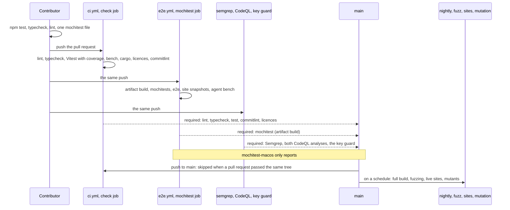

# Testing: from a pull request to the nightly runs

This page follows a change through Vimma's tests: what a contributor runs before pushing, what
each pull request runs and which of those checks the ruleset requires, and what runs later on a
schedule. For each layer it says what the layer proves, where it runs, and how to run it
locally, and it ends with what no layer covers. [ARCHITECTURE.md](../../ARCHITECTURE.md),
"Testing", is the one-table summary and "Automation and release infrastructure" lists every
workflow; the commands are in [CONTRIBUTING.md](../../CONTRIBUTING.md), "Testing", and the
procedures, switches and recovery in [docs/runbook.md](../runbook.md), "Testing" and "CI and
automation". The specs are [m0-pipeline](../specs/m0-pipeline.md),
[ci-quality-gates](../specs/ci-quality-gates.md), [m0-e2e-harness](../specs/m0-e2e-harness.md),
[m7-fuzzing](../specs/m7-fuzzing.md) and [site-compat](../specs/site-compat.md), and the decision
to test pull requests on artifact builds is [ADR-010](../adr/010-pr-artifact-builds.md).

## The required checks

The ruleset on `main` (`gh api repos/vimma-browser/vimma/rules/branches/main` shows the current one)
requires these checks: `lint, typecheck, test, commitlint, licences` (the `check` job of `ci.yml`),
`mochitest (artifact build)` (`e2e.yml`), the Semgrep scan, the two CodeQL analyses, and
`Mozilla release key unchanged or approved` (`key-guard.yml`). Green checks are not all a merge
needs: the ruleset also blocks one while CodeQL reports a security alert of high severity or more,
or another alert at error level, and while a review thread is unresolved. A docs-only pull request
(`tools/ci/docs-only.mjs`, as the base branch has it) skips the steps Markdown cannot affect and the
mochitest job, and each still reports success. The `opened` and `synchronize` events of a draft skip
the three slow required checks, the mochitest job with the e2e scenarios, the Semgrep scan and both
CodeQL analyses, until the pull request is marked ready. The details are in docs/runbook.md,
"Docs-only pull requests", "Draft pull requests" and "Once per tree".

## 1. Unit tests: Vitest

**What it proves.** vimma-core's logic, with no Firefox: the dispatcher, keymap, config and
theme parsing, the workspace and pane models, the control protocol validator, the agent gate's
queue, update manifests and the rest; and the Node tools under `tools/`, including tests of the
workflows themselves (`tools/test/`) and the e2e harness against a fake control server.

**Where.** `vitest.config.mjs` takes every `*.test.mjs` under `packages/**/test/` and
`tools/**/test/`, with a global setup (`tools/test/tmp-guard.mjs`) that fails a test leaving
files in its temporary folder. The `check` job runs `npm run coverage`, which fails below 90 %
of lines, functions, branches and statements in `packages/vimma-core/src/` (the vendored
smol-toml excluded). There is no coverage figure for the browser code.

**Locally.** `npm test`, or `npx vitest run <file>`.

## 2. Properties and fuzzing

**What it proves.** That the parsers of outside input (the control protocol, `config.toml`, the
routing rules, key notation, the command line, the Omarchy theme reader, agent keys, and
vimma-ctl's JSON and protocol decoders) hold their invariants on generated input: a result is
either well formed or a located error, never an exception, and an accepted value holds only what
the schema allows.

**Where.** The fast-check properties in `packages/vimma-core/test/fuzz/` go through `harness.mjs`:
in every Vitest run they use a fixed seed (`FIXED_SEED`), so a red run is red again on a re-run, and
`RUNS` (100) cases times each property's `weight`, which takes most to 500, 1000 or 2000 cases and a
slow one to 20. `properties.test.mjs` holds more properties of the key notation and the dispatcher.
On the Rust side, `tools/vimma-ctl/tests/protocol_props.rs` and `mcp_props.rs` use proptest and run
with `cargo test`. `fuzz.yml` runs both sets every night (02:41 UTC) from a random seed with many
more cases; a failure uploads the seed and the failing cases and opens or comments on one issue
labelled `fuzz-failure`.

**Locally.** `VIMMA_FUZZ_SEED=<seed> npx vitest run packages/vimma-core/test/fuzz`, and
docs/runbook.md, "Fuzzing: reproducing a failing seed".

## 3. Contract fixtures

**What it proves.** That a file or message written by one version is read correctly by the next,
and that the browser and `vimma-ctl` agree on the protocol.

**Where.** `tests/contract/` holds the fixtures by version: `config/v1/` and `v2/` (a valid file,
invalid ones and their expected errors), `control/v1/` and `v2/`, `state/v1/` (the window snapshot),
`workspaces/v1/` (the definitions file), and sample Omarchy themes in `theme/`. vimma-core's tests
read them all (for example [contract.test.mjs](../../packages/vimma-core/test/contract.test.mjs)),
and vimma-ctl's tests in `tools/vimma-ctl/src/protocol.rs` and `src/mcp/` read the `control/` ones,
so both sides of the socket check the same lines. A new schema version adds a folder.

**Locally.** `npm test` and `cargo test` in `tools/vimma-ctl`.

## 4. vimma-ctl: Rust

**What it proves.** The CLI, the MCP server's argument checks and tool list, the protocol client
and the discovery file checks, against a fake server.

**Where.** The `check` job runs `cargo fmt --check`, `cargo clippy --locked --all-targets -- -D
warnings`, `cargo test --locked` and the crate licence check. The job `vimma-ctl on macOS` runs
clippy and the tests on a Mac and is not required.

**Locally.** `cargo test` and `cargo clippy -- -D warnings` in `tools/vimma-ctl`.

## 5. The bench gate

**What it proves.** That core's key-to-action time stays under 50 µs a key and does not regress:
the suite no more than 10 % slower than the baseline commit, and no case more than 25 %.

**Where.** A step of the `check` job, `npm run bench -- --check` (`tools/bench/bench.ts`, cases
in `packages/vimma-core/bench/cases.mjs`). It measures the working tree and the baseline commit
named in `baseline.json` in the same processes, so the runner's speed cancels out. Why it does
not flake and how to move the baseline on purpose: docs/runbook.md, "Bench baseline".

**Locally.** `npm run bench`.

## 6. Mochitests on an artifact build

**What it proves.** The browser code in a real Firefox: key capture and dispatch, every runner,
the actors in real pages, the UI, workspaces and panes over real tabs, the control socket and the
agent gate, theme and config loading. The files are `tests/browser/browser_vimma_*.js` with their
`file_vimma_*` fixtures, each listed in `tests/browser/browser.toml`. `browser_vimma_perf.js`
also checks key-to-paint times against budgets set from CI runs.

**Where.** The required `mochitest (artifact build)` job of `e2e.yml`, on a hosted Linux runner.
It downloads Firefox's source for `surfer.json`'s release and checks it
(`tools/upstream/firefox-source.sh`), runs `npm run import`, makes the artifact build
(`tools/artifact-build/artifact-build.mjs`: Vimma's front end over Mozilla's compiled binaries
for the same release), and runs `npm run mochitest -- --artifact tests/browser/` with
`VIMMA_REQUIRE_CTL=1`, so the vimma-ctl task fails rather than skips. Files that test
compiled-in parts are marked `skip-if = ["artifact"]` in `browser.toml` (at present the crash
reporter, the `--version` line and the updater); `nightly.yml` runs the whole suite on a full
build. The separate job `mochitest (artifact build, macOS)` (`mochitest-macos`) only reports: on
a hosted Mac it runs `npm test` and the same suite, without `vimma-ctl` (so
`browser_vimma_control.js` skips), and it has no draft skip.

**Locally.** In a worktree, `npm run lane:setup` once (a copy of the primary checkout's engine,
docs/runbook.md, "Parallel browser lanes"), then
`npm run mochitest -- --artifact tests/browser/browser_vimma_<name>.js`. A suspected race: the
same file with `--repeat=N` on two busy CPUs (docs/runbook.md, "Mochitests that send keys to a
page").

**Type checking.** `npm run typecheck` checks the mochitests and their helpers too, without a
browser: `tests/tsconfig.json` with the harness's globals declared in `types/mochitest/`
(`harness.d.ts` for `add_task`, `Assert`, `BrowserTestUtils`, `SpecialPowers` and the rest,
`firefox.d.ts` for the Firefox members only tests use, `vimma.d.ts` for Vimma's types a test
names, and `head.d.ts`, which `npm run gen-mochitest-head` generates from the `head*.js` files).
`tools/mochitest-typecheck.ts` holds the program to `tools/test/mochitest-allowlist.txt`: a listed
file may still have type errors, every other file, a new one included, may not, and a listed
file that has none must come off the list. `Assert.equal` and its kin take an expected value of
the actual one's type, and `Assert.ok` refuses a promise, so a test that compares a value with
the wrong kind of thing, or asserts on a promise it forgot to await, fails the check. That holds
only where the actual value has a type: `ChromeUtils.importESModule` returns `any` here, so what
a test reads from one of Vimma's modules, and the JSDoc types a test gives such values, are not
checked against the module yet; typing `importESModule` for each `chrome://` URL of Vimma's is
the next step.

## 7. End-to-end scenarios and screenshots

**What it proves.** That a real build, started as a user starts it with a fresh profile, does
what a scenario says, driven only from outside through the control socket, and that the screens
it photographs match their baselines.

**Where.** In the same `e2e.yml` job: first the harness's own tests (`npx vitest run
tools/e2e/`, with a real Xvfb and vimma-ctl), and after the mochitests the scenarios,
`npm run e2e -- --artifact`. `tools/e2e/e2e.ts` runs each JSON scenario in
`tests/e2e/scenarios/` in its own temporary profile and browser under its own Xvfb, sends keys
and reads state with vimma-ctl, and can restart the browser on the same profile, or kill it as a
crash would. A screenshot is compared with `tests/e2e/baselines/<name>.png` (`screenshot.ts`): a
pixel differs when a channel is more than 2 off, and more than 0.5 % of differing pixels fails.
A scenario marked pending is reported as a notice and passes nothing; the suite has a 5-minute
budget; `--update-baselines` is refused when `CI` is set, so a baseline changes only in a
reviewed commit that says why.

The browser gets an allowlisted environment (`browserEnv` in `launcher.ts`): none of the
desktop's scaling, theme, locale or Wayland variables, but fixed ones (`LANG=C.UTF-8`, `TZ=UTC`,
`GTK_THEME=Adwaita`) and `HOME` inside the profile; the profile pins the pixel ratio and a light
theme.
On Linux the browser renders with the fonts vendored in `tests/e2e/fonts/`, and the fixture
pages are served on the fixed port 28471 (a second run on the machine stops with a message
rather than take another port), so two runs draw the same pixels. A baseline comes from CI's
runner: CI compares with it at 0.00 %, and a local run at up to 0.13 % (the line under the
toolbar, drawn in a GTK colour, and the system's FreeType). A scenario carries on past a screenshot that differs and fails at its end, so one CI run
supplies every image of a re-record (docs/runbook.md, "End-to-end tests", "Baselines").

The same job then runs the site snapshot gate (section 8) and the agent bench with its scripted
provider (`npm run agent-bench -- --artifact --check --lists L04 --two-shops`,
[docs/agent-bench.md](../agent-bench.md)),
which needs no model.

**Locally.** `npm run e2e -- --xvfb --artifact --filter <name>`; throwaway scenarios with
`--scenarios`, `--baselines` and `--out` in folders of your own.

## 8. Site compatibility

**What it proves.** That hints, scrolling, find, `yy`, insert and Esc, and `ctrl+b` work on real
sites, and that Vimma's code logs no error there.

**Where.** Two layers of `tools/sites/`. The snapshot gate in `e2e.yml`,
`npm run sites -- --offline --artifact`, replays pages recorded in `tests/e2e/fixtures/sites/`
with every host but 127.0.0.1 unreachable, and fails the pull request when a check that passed
on the recording fails now. The live suite, `sites.yml`, loads every site of
`tools/sites/sites.json` each night (04:30 UTC); it is a report, never a gate, and a new
regression against the previous night opens or updates one issue labelled `site-compat`.

**Locally.** The offline gate, `npm run sites -- --offline --artifact`. The live suite belongs to
the nightly runner: repeated visits from one address draw the sites' bot checks.

## 9. Mutation testing

**What it proves.** Whether core's tests notice a change to the code: Stryker mutates
`packages/vimma-core/src/` (not the vendored parser) and runs the tests against each mutant.

**Where.** `mutation.yml`, Sundays at 04:23 UTC, incremental from the last run's results and
from scratch on the first Sunday of a month. Surviving mutants go into one issue labelled
`mutation`, rewritten by each run (`tools/mutation/report.ts`); they never fail the run, only a
broken Stryker run does.

**Locally.** `npm run mutation`; reading the report: docs/runbook.md, "Mutation testing".

## 10. The rest of a pull request's checks

The `check` job also runs eslint, prettier, the wording checks (`tools/md-wording/`), spec-lint,
arch-lint, changelog-lint, a check that the generated docs are current (`npm run gen-docs`), the
Python tests of the upstream tools (`npm run test:py`), the test links of
[docs/security.md](../security.md) (`npm run security-links`), the npm and crate licence checks,
the MPL headers and commitlint. Semgrep and CodeQL scan the code. The workflows that build
packages (`pkgbuild.yml`, `flatpak.yml`, `macos.yml`) have triggers of their own, listed in
ARCHITECTURE.md.

## What is not covered

- **Full builds on pull requests.** Pull requests test the front end on Mozilla's binaries. A
  change to a `.patch`, C++, `moz.build`, `configs/` or branding is compiled only by a full
  build: the nightly, the macOS build of `macos.yml`, a release, or the contributor's own full
  build, whose mochitest run the pull request must report
  ([CONTRIBUTING.md](../../CONTRIBUTING.md), "Testing"). The nightly runs at 03:00 UTC only while
  the repository variable `NIGHTLY_ENABLED` is `true`. Its `changes` job
  (`tools/update/nightly-change.mjs`) skips a scheduled build only when public nightlies are on
  and the rolling release already records the same commit and Firefox version; anything else,
  a doubt included, builds.
- **The updater end to end.** The e2e updater scenarios need a `VIMMA_UPDATES=1` build packaged
  with `mach package`, which no pull request job makes; they are reported pending in CI and run
  by hand (docs/runbook.md, "End-to-end tests").
- **macOS.** Its mochitest job reports without blocking, and its e2e runs headless, without
  screenshots, in the smoke jobs of `macos.yml` and `release.yml`.
- **Window managers and desktops.** The e2e browser runs on X11 under Xvfb at one size and one pixel
  ratio, so Wayland and HiDPI screens are not exercised there. Hyprland is a fake made of two Unix
  sockets in `browser_vimma_private_swap.js`; the Omarchy hook script runs with fake `busctl`,
  `vimma-ctl` and `vimma` in `tools/omarchy/test/`.
- **Real sites and real accounts.** Only the recorded pages gate; the live suite is a report,
  and no test logs in to a real account.
- **Real model providers.** The agent bench in CI uses a scripted provider; a run against real
  models is by hand ([docs/agent-bench.md](../agent-bench.md)).
- **Coverage of the browser code.** The coverage gate and mutation testing reach vimma-core only;
  the browser code under `src/` has its mochitests and e2e scenarios but no coverage figure.
- **Windows**, which is not a target.

When a test fails on CI and passes locally, the rule is a fix for its cause, never a retry or a
sleep: reproduce it in a lane first, then follow docs/runbook.md, "Testing".
