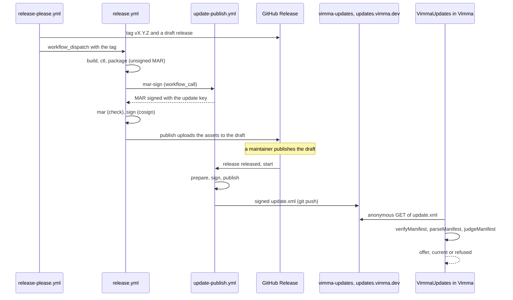

# From a release tag to an offered update

This page follows one Vimma release from the moment its version is decided to the moment an
installed browser offers it. It names the workflows, jobs, scripts and functions in the order
they run, and what can stop the release at each step.
[ARCHITECTURE.md](../../ARCHITECTURE.md) lists the workflows; the behaviour is in
[m6-packaging](../specs/m6-packaging.md), [release-versioning](../specs/release-versioning.md),
[m6a-updater](../specs/m6a-updater.md) and [update-notices](../specs/update-notices.md), the
decision in [ADR-016](../adr/016-own-update-channel.md), the rules with their tests in
[docs/security/](../security/README.md) §14 (build and release) and §16 (update check), and setup,
switches and recovery in [docs/runbook/](../runbook/README.md), "Releases", "Release packages" and
"Update signing keys and the update host".

## 1. The version: release-please

Every push to `main` runs `release-please.yml`. Its `release-please` job keeps one release pull
request open, `chore(main): release X.Y.Z`, with the next version and its `CHANGELOG.md` entry,
both computed from the Conventional Commits since the last tag. The version's one source is
`brands.vimma.release.displayVersion` in `surfer.json`; the Firefox pin beside it is never touched
here. `firefox-notes` names the Firefox the release builds on in the changelog heading.

Merging that pull request is the release: release-please tags `vX.Y.Z` and creates a draft GitHub
Release. A tag pushed with `GITHUB_TOKEN` starts no workflow, so the `release-build` job checks the
tag's form and dispatches `release.yml` on `main` with it. While the repository variable
`RELEASE_ENABLED` is not `true`, the release pull request, the tag and the draft still happen,
but no build starts: `release-build` and every job of `release.yml` require it.

## 2. The build: `release.yml`

`release.yml` runs only by `workflow_dispatch`, and every job requires `refs/heads/main`. That is
what makes its signatures mean something: the signing identity names `release.yml` on `main`,
which no other branch can obtain. Tests:
[release-workflow.test.mjs](../../tools/package/test/release-workflow.test.mjs) ("starts only by
workflow_dispatch with a tag, so publishing a release rebuilds nothing", "builds only a vX.Y.Z
tag whose commit is on main").

1. **`build`** (read-only token, the `build` environment for the Safe Browsing key). It refuses a
   tag that is not `vX.Y.Z`, not on `main`, or different from `surfer.json`'s version. It gets
   Firefox's source only through `tools/upstream/firefox-source.sh`, which checks the tarball
   against Mozilla's signed `SHA512SUMS` before extracting it
   ([ADR-021](../adr/021-mozilla-release-key.md)), restores nothing from the Actions cache, fixes
   `MOZ_BUILD_DATE` so the binary and `application.ini` carry one build ID
   (`tools/release/build-id.mjs` fails a package where they differ), and builds with
   `VIMMA_UPDATES=1`: Firefox's updater with Vimma's channel, update host and certificates
   (`configs/common/mozconfig`). It then runs a smoke check, packages with mach, packs the MAR
   tools (`tools/update/mar-tools.mjs`) and writes the CycloneDX SBOM (`tools/package/sbom.mjs`).
2. **`ctl`** builds `vimma-ctl` as a static musl binary and its licence notices.
3. **`package`** runs `tools/package/package.mjs`, which turns the mach tarball into the release
   tarball, the AppImage, the `.deb`, the `.rpm`, the `vimma-bin` PKGBUILD and SRCINFO, and
   `SHA256SUMS`, each with `vimma-ctl` beside the browser. It smoke-tests the `.deb`, the AppImage,
   the `.rpm` (Fedora and openSUSE containers) and the PKGBUILD (an Arch container), and checks the
   tarball's updater with `tools/update/check-build.mjs`: it asks `updates.vimma.dev`, both channel
   files say `vimma`, and it embeds Vimma's certificates and none of Mozilla's. With
   `UPDATES_ENABLED`, `tools/update/mar.mjs build` makes the complete MAR from the release tarball
   with Mozilla's `make_full_update.sh` and a zeroed signature placeholder
   (`addSignaturePlaceholder`).
4. **`mar-sign`** calls `update-publish.yml`'s job of that name. It runs no repository code: it
   checks the file is this caller's MAR for the `vimma` channel with one zeroed SHA-384
   placeholder, signs the bytes around it with the update key in Google Cloud KMS through GitHub's
   OIDC token, checks the signature with `openssl` and writes it in. The key admits only a token
   that names `update-publish.yml` on `main`.
5. **`mar`** checks the result with no secret: `mar.mjs same-content` (only the signature bytes
   differ from the placeholder), `mar.mjs verify` against `configs/updater/primary.der` and
   `secondary.der`, Mozilla's own `signmar` against an NSS database of each certificate, and a
   file-by-file `diff` of the MAR's contents against the release tarball. Only then does
   `SHA256SUMS` list it. A skipped or failed `mar-sign` fails here, loudly. Tests:
   [mar.test.mjs](../../tools/update/test/mar.test.mjs).
6. **`sign`** (`SIGNING_ENABLED`; `id-token: write` only, no repository code) signs every asset
   and `SHA256SUMS` with `cosign sign-blob` keyless, leaving a `.sigstore.json` bundle beside
   each. Its certificate names `release.yml` at `refs/heads/main`, the identity that
   `IDENTITY_REGEXP` in `package.mjs`, the guide and `aur.yml` check. There is no separate
   provenance attestation; the Sigstore bundle is the signature users verify.
7. **`publish`** (`contents: write` only) uploads to the draft. It refuses a release that is
   already published unless the run says `replace_published`, and a tag that no longer points to
   the commit that was built, then puts the update steps and the third-party notice into the
   release notes.

The macOS jobs (`macos-ctl` to `macos-tap`) build, notarise and add the `.dmg` to the same release
([macos-build](../specs/macos-build.md)); no Linux job needs them. Any failed job opens or updates
a release-failure issue (`failure`).

## 3. Publishing: `update-publish.yml`

A maintainer publishes the draft; that click rebuilds nothing. The `released` event starts
`update-publish.yml`, whose `start` job only dispatches the same workflow again on `main` with the
tag, so that every job with a secret runs from `main`'s copy of the file. The published release
also starts `aur.yml` and `homebrew.yml`.

1. **`prepare`** (no secret) checks that the release is published and its tag is on `main`,
   downloads the target's files, verifies `SHA256SUMS` against its cosign bundle with the
   `release.yml@refs/heads/main` identity, and runs `tools/update/manifest.mjs`:
   `commits` lists the commits since the previous release, whose types and labels make the update
   a security release (`urgencyOf`); `build` checks every file against the sums (`checkAssets`),
   reads the build ID from the tarball's `application.ini` (`releaseInfo`), and writes the
   unsigned body (`buildManifest`). Its serial is the UTC time it is made and must be newer than
   both the manifest the host serves and the one in the `vimma-updates` repository
   (`nextSerial`).
2. **`sign`** (environment `update-signing`, `id-token: write` only, no repository code) checks
   the body's shape for this channel and target, signs `vimma-update-xml-v1` and a newline
   followed by the body with Cloud KMS (RSASSA-PKCS1-v1_5, SHA-384), and checks it with `openssl`.
3. **`publish`** (environment `update-publish`, the deploy key of `vimma-updates` alone) checks
   the signed file again with `manifest.mjs verify` under the key the browser pins and with
   `openssl`, commits it to `vimma-updates` at
   `public/updates/browser/Linux_x86_64-gcc3/vimma/update.xml` (never forced), and waits until
   `updates.vimma.dev` serves it. Without `UPDATES_ENABLED`, or in a dry run, it signs and checks
   everything and pushes nothing.

`-f offer=nothing` publishes a signed manifest that offers no update, which pulls a bad release
back. The macOS `.dmg` gets its own manifest under `Darwin_aarch64-gcc3`. Tests:
[update-workflow.test.mjs](../../tools/update/test/update-workflow.test.mjs) and
[manifest.test.mjs](../../tools/update/test/manifest.test.mjs); rules UP7 and UP14.

## 4. The pinned keys

Two copies of the same trust anchor ship in every build, both made from
`configs/updater/primary.der` and `secondary.der`:

- Firefox's updater embeds the certificates and checks every MAR against them before applying it.
  `npm run import` links them in (`tools/import/`), and the mozconfig refuses a `VIMMA_UPDATES=1`
  build whose copies are missing or differ from the committed ones, since Firefox would otherwise
  fall back to Mozilla's test keys or embed other keys.
- `npm run gen-update-keys` (`tools/update/gen-update-keys.mjs`) writes their public keys into
  `packages/vimma-core/src/updates/update-keys.mjs` (`UPDATE_KEYS`), which the manifest check uses.
  Until the offline recovery key exists, only the primary is pinned and the secondary slot repeats
  it.

## 5. The client's check: `updates/VimmaUpdates.sys.mjs`

`vimma.js` calls `VimmaUpdates.init` once per process. It loads the last result, checks 5 s after
the first window's delayed startup when a check is due, and asks every hour whether one is due
(`maybeCheck`, core `checkDue`, with `app.update.interval` at 12 hours); `:update` checks at once.
No request goes out before `config.toml` is read, because `[updates] check = false` may turn checks
off, and a build run from source checks nothing.

`runCheck` fetches `manifestUrl()`, the pref `vimma.update.url` with only `%BUILD_TARGET%` and
`%CHANNEL%` filled in and only `https`, with no cookies, no cache, no referrer, an empty
`Accept-Language` and no redirects, and reads at most 256 KiB after decompression (`readCapped`).
A host that does not answer is `unreachable`, logged and otherwise quiet. `judge` then applies
core's rules (`packages/vimma-core/src/updates/updates.mjs`):

1. `verifyManifest` checks the signature line against `UPDATE_KEYS` (plus test keys only in
   automation). A missing, altered or foreign signature is `refused`.
2. `parseManifest` reads the body, and `judgeManifest` refuses another channel or target, a
   serial older than the one this profile accepted or than the running build, and one more than a
   day ahead; an older or equal build is no offer.
3. The serial is stored in `vimma.update.serial`; the outcome (`offer`, `current`, `refused`,
   `unreachable`) feeds the status bar and about:vimma. Three refusals in a row are shown.

What happens to an offer depends on the install type (`installInfo`, core `installTypeFrom`):

- **AppImage:** `replaceAppImage` downloads the offered AppImage beside itself, anonymously, checks
  its size and SHA-512 against the signed manifest, and renames it over its own file.
- **Tarball with Firefox's updater:** Firefox's own timer checks instead.
  `UpdateService-sys-mjs.patch` calls `VimmaUpdates.beforeCheck` (anonymous, capped) and
  `VimmaUpdates.verify` (the same `judge`) before Firefox parses the answer, so a manifest that
  fails the rules never reaches Firefox's parser. Firefox downloads the MAR without cookies
  (`onMarRequest`), and its updater checks the MAR's signature against the embedded certificates.
- **Package managers** (`.deb`, `.rpm`, PKGBUILD, Flatpak, Homebrew) install nothing: Vimma shows
  the command that updates them (`updateSteps`).

Tests: [updates.test.mjs](../../packages/vimma-core/test/updates.test.mjs),
[browser_vimma_update_check.js](../../tests/browser/browser_vimma_update_check.js),
[browser_vimma_update_verify.js](../../tests/browser/browser_vimma_update_verify.js),
[browser_vimma_update_appimage.js](../../tests/browser/browser_vimma_update_appimage.js) and
[browser_vimma_updater.js](../../tests/browser/browser_vimma_updater.js); rules UP1 to UP6, UP8 to
UP11 and UP13.

## The nightly channel

`nightly.yml` builds `main` every day the same way, with three differences. The package is set to
the `vimma-nightly` update channel (`tools/update/channel.mjs`) and checked with `check-build.mjs`
for that channel; the build's own channel stays `vimma`, which picks the updater's certificates. Its
cosign identity is `nightly.yml`, which `release.yml`'s checks never accept. And only while
`NIGHTLY_RELEASE_ENABLED` and `UPDATES_ENABLED` are both on does it publish: the same `mar-sign` job
signs the MAR on the nightly channel, `publish` uploads to the rolling `nightly` pre-release, and
`update-publish.yml`'s `nightly-prepare`, `nightly-sign` and `nightly-publish` write
`…/vimma-nightly/update.xml`. On a day when `main` and the Firefox version did not change, the
`changes` job skips the build and the manifest is re-signed under a new serial, so a nightly install
never sees a feed older than its 7-day limit (45 days for releases). Tests:
[nightly-workflow.test.mjs](../../tools/test/nightly-workflow.test.mjs) and
[nightly-manifest.test.mjs](../../tools/update/test/nightly-manifest.test.mjs).
