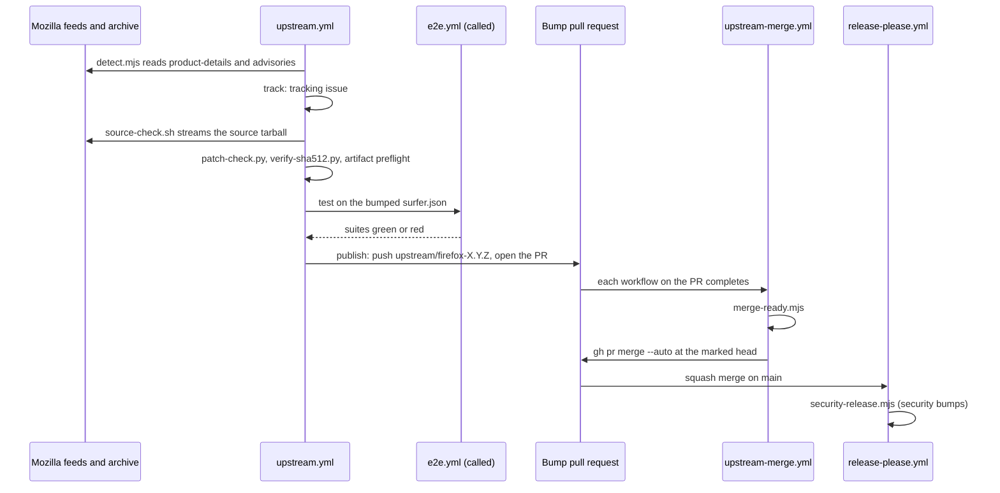

# From a Firefox release to a merged bump

This page follows one Firefox release, say 158.0.1, from the moment Mozilla lists it to the moment
the commit that moves Vimma onto it lands on `main`, and, for a security release, on to the Vimma
release that ships it. It names the workflows, jobs and scripts in the order they run, and what
stops the bump at each step. [docs/rebase.md](../rebase.md), "1. The autopilot: from release to PR",
is the maintainer's guide to the same jobs and to what to do when the bump stops; the decisions are
[ADR-002](../adr/002-upstream-release-channel.md), [ADR-015](../adr/015-upstream-autopilot.md),
[ADR-020](../adr/020-security-release-without-a-person.md),
[ADR-021](../adr/021-mozilla-release-key.md) and [ADR-022](../adr/022-green-bump-merges-itself.md);
the behaviour is in [m7-upstream-autopilot](../specs/m7-upstream-autopilot.md) and
[upstream-bump-automation](../specs/upstream-bump-automation.md); the rules with their tests are G1
to G15 in [docs/security.md](../security.md) §10; setup and switches are in
[docs/runbook.md](../runbook.md), "Upstream bumps".

## 1. Detection: `detect`

`upstream.yml` runs every 4 hours (`17 */4 * * *`) and by hand. Its `detect` job has a read-only
token and no secret, and does three things:

- `tools/upstream/mozilla-key-check.py` compares Mozilla's current release key with the pinned
  `tools/upstream/mozilla-release-key.asc` and reports a new subkey, a revocation or a key near
  expiry; the `key` job turns that into a `security` issue. A failed download only warns, so it
  never stops release detection.
- `tools/upstream/detect.mjs` reads product-details (`firefox_versions.json`, `firefox.json`) and
  Mozilla's advisories index through `releases.mjs`, and answers whether a release newer than
  `surfer.json`'s pin exists, whether it is a major or a dot release (`classify`), whether an MFSA
  advisory names it, and how far behind `main` is (`drift`). An unreadable advisories page makes
  security "unknown", which counts as a security release (G3).
- The "What is already done" step checks whether the branch `upstream/firefox-X.Y.Z` exists. If it
  does, the release was handled, and the heavy jobs do not run again unless the run was started
  with `rebuild=true`.

`track` opens or labels the tracking issue "Firefox X.Y.Z released" (`upstream`, and `security`
when it is or may be one). `drift`, when `main` is past its limit (3 days behind a security dot
release, 7 for a major, 14 otherwise), opens an issue and fails the run (G2). Tests:
[releases.test.mjs](../../tools/upstream/test/releases.test.mjs),
[autopilot.test.mjs](../../tools/upstream/test/autopilot.test.mjs) and
[upstream-workflow.test.mjs](../../tools/test/upstream-workflow.test.mjs).

## 2. The source and the patches: `patch-check`

`patch-check` (read-only) runs `tools/upstream/source-check.sh X.Y.Z`, shared with the Beta canary
so that the two checks cannot drift apart. It accepts only a version of digits, dots and a Beta's
`bN`, then streams the source tarball from archive.mozilla.org once through `tee`:

1. One copy goes to `sha512sum`. The other goes to `patch-check.py --tarball - --drain`, which
   extracts only the files Vimma patches and dry-runs every `src/**/*.patch` with
   `git apply --check` and Surfer's flags. Each patch gets a verdict: `clean`, `offset`, `applied`, `fuzz` or
   `failed` (the last two fail `surfer import`), and a failing patch is checked hunk by hunk.
2. `verify-sha512.py` checks with `gpgv` that `SHA512SUMS.asc` is a good signature by the pinned
   key (by its fingerprint, `PINNED_FINGERPRINT`), then that the tarball's SHA-512 matches its line
   in `SHA512SUMS`. A bad signature, a mismatch or a file that cannot be fetched exits 1, and no
   report is uploaded: nothing is ever reported on or built from a tarball Mozilla did not publish
   (G4).
3. From the verified tarball only, `upstream-prefs.mjs` computes the refresh of the prefs Vimma
   copies from upstream (`prefs-refresh.patch`) and `reexport.py` re-exports patches that applied
   only with fuzz. Then `patch-audit.py` measures every patch against ADR-003's register (a report
   that never fails the check), and, when every patch applies, `artifact-preflight.mjs` asks
   Mozilla's Taskcluster index whether compiled binaries for the release's revision exist
   ([ADR-010](../adr/010-pr-artifact-builds.md)).

Its outputs (`result=ok|fail|norun`, `artifacts=yes|no|unknown`) decide the rest. A failed patch
also starts `patch-issue`, which opens one triage issue per version with `GITHUB_TOKEN` only.
Tests: [source-check.test.mjs](../../tools/upstream/test/source-check.test.mjs),
[test_patch_check.py](../../tools/upstream/test_patch_check.py),
[test_verify_sha512.py](../../tools/upstream/test_verify_sha512.py) and
[artifact-preflight.test.mjs](../../tools/upstream/test/artifact-preflight.test.mjs).

## 3. The suites on the new release: `test`

Only when `result` is `ok` and `artifacts` is `yes`, `test` calls `e2e.yml` with
`firefox-version` and the `patch-check` artifact. In its own checkout, `e2e.yml` bumps
`surfer.json` with `tools/upstream/bump-surfer-json.py` (a textual edit, re-parsed to prove that
only `version.version` changed, and a Beta refused), applies the pref refresh, gets the source
again through `firefox-source.sh` (signature and hash checked a second time), imports, makes the
artifact build (`tools/artifact-build/`) and runs `tests/browser/` and `tests/e2e/`, as it does for
any pull request. No secret reaches any of this (G6). Without artifacts the suites are skipped and
the pull request says so; the full-build path is then a person's ([docs/rebase.md](../rebase.md),
steps 2 to 4).

## 4. The pull request: `publish`

`publish` runs even after red suites, but never without a finished patch check. It is the only
job that writes, in the `upstream-autopilot` environment, which only `main` may use; it mints a
token of the org's GitHub App when one is set up, because a pull request opened with
`GITHUB_TOKEN` starts no CI.

1. **The branch.** `bump-surfer-json.py` sets the version; the pref refresh is applied to
   `firefox-branding.js`; the commit is `upstream: firefox X.Y.Z`. Re-exported patches go in a
   second commit, copied only from `src/**/*.patch` paths. On a rebuild, auto-merge already set on
   the old head is turned off first. The branch `upstream/firefox-X.Y.Z` is then pushed; only this
   job writes `upstream/*` branches.
2. **The allowlist.** `tools/upstream/bump-diff.mjs` reads the branch as pushed against its
   merge-base with `main` and answers whether the diff is a plain bump: `surfer.json` changes only
   `version.version`, and `firefox-branding.js`, if at all, only the copied pref lines. A new,
   deleted or renamed file, another line, or a re-exported patch is not. Any failure here leaves no
   verdict, which keeps auto-merge off.
3. **The body and its decisions.** `tools/upstream/autopilot-body.mjs` writes the title and body
   from every report, and decides two things. `draftDecision`: a draft when a patch does not
   apply and none was re-exported, a copied pref is gone upstream, the suites did not pass, or no
   App token exists (G5).
   `autoMergeDecision`: on only when `AUTO_MERGE_UPSTREAM` allows the release kind (`dot`, or
   `all`), the run is on `main`, the App is set up, no patch was re-exported, the pull request is
   not a draft, every patch applied `clean` or with an `offset`, Mozilla's artifacts exist, and
   `bump-diff.mjs` said yes. When it is on, the body carries a hidden marker naming the head
   commit that was checked (`autoMergeMarker`). `publish` itself never sets auto-merge.
4. **The pull request.** `gh pr create`, or an edit of the open one; when the repository does not
   let Actions open pull requests, a comment with a prefilled compare link on the tracking issue
   instead (G1). Older bump pull requests and tracking issues are closed as superseded.

Tests: [autopilot.test.mjs](../../tools/upstream/test/autopilot.test.mjs) ("a ready PR only when
patches apply, suites pass and a token starts CI", "names the first condition that did not hold"),
[bump-diff.test.mjs](../../tools/upstream/test/bump-diff.test.mjs) and
[upstream-workflow.test.mjs](../../tools/test/upstream-workflow.test.mjs) ("the allowlist reads
the branch as pushed", "rebuild disables auto-merge before the push").

## 5. The merge: `upstream-merge.yml`

The pull request runs every workflow an ordinary one does. Each time one of `CI`, `CodeQL`, `e2e`,
`flatpak`, `key-guard`, `macos`, `pkgbuild` or `Semgrep` completes, `workflow_run` starts
`upstream-merge.yml` from `main`'s copy, never the branch's. Its job runs only for a pull-request
run from this repository on an `upstream/firefox-*` branch with the App set up, and hands the
pull request, every run on the head and every check to `tools/upstream/merge-ready.mjs`.
`mergeReady` answers no, with the first reason, unless:

- the pull request was opened by `vimma-upstream-autopilot[bot]` and is not a draft;
- its head is the commit the event names, and the body's marker names that same commit;
- auto-merge is not already on;
- every pull-request run on that head has completed as success, skipped or neutral, and no
  completed check failed. This holds the merge for checks the `main` ruleset does not require,
  such as the macOS mochitests and the package checks.

When the answer is yes, the job runs `gh pr merge --auto --squash --match-head-commit` with the
App's token, whose merge, unlike one made with `GITHUB_TOKEN`, starts the push workflows on
`main`. GitHub's auto-merge still waits for every required check and code scanning. A red,
cancelled or unapproved run leaves the bump for a person; re-running it green starts the decision
again (G13). Tests: [merge-ready.test.mjs](../../tools/upstream/test/merge-ready.test.mjs) and
[upstream-merge-workflow.test.mjs](../../tools/test/upstream-merge-workflow.test.mjs).

## 6. After the merge: a security release

The squash merge is a push to `main`, so `release-please.yml` runs and adds the bump to the open
release pull request. When the merged bump carried the `security` label and the repository
variable `AUTO_SECURITY_RELEASE` is on, its `security-release` job runs
`tools/release/security-release.mjs`: `decide()` checks every condition on what `gather()` read
from the API (never the first release, only the autopilot's merged `security` pull request) and
sets the release pull request to auto-merge, pinned to its head, through the release-please
token. The release then follows
[From a release tag to an offered update](updates-and-release.md); publishing its draft stays a
person's click ([ADR-020](../adr/020-security-release-without-a-person.md), G11, G12). Tests:
[security-release.test.mjs](../../tools/release/test/security-release.test.mjs).

## The Beta canary

`upstream-beta.yml` runs the same checks against each Firefox Beta every 6 hours, about two weeks
before the release ([upstream-beta-canary](../specs/upstream-beta-canary.md)). Its `detect` reads
the current Beta, `source-check` runs the same `source-check.sh`, and `test` calls `e2e.yml` in
Beta mode, where `bump-surfer-json.py --allow-beta` changes only that job's checkout. It never
pushes, commits, opens a pull request or changes the Firefox pin; its only output is a
"Firefox N beta: canary findings" issue, which the bump's pull request names when the release
arrives (G9, G10). Tests:
[upstream-beta-workflow.test.mjs](../../tools/test/upstream-beta-workflow.test.mjs) and
[canary.test.mjs](../../tools/upstream/test/canary.test.mjs).
