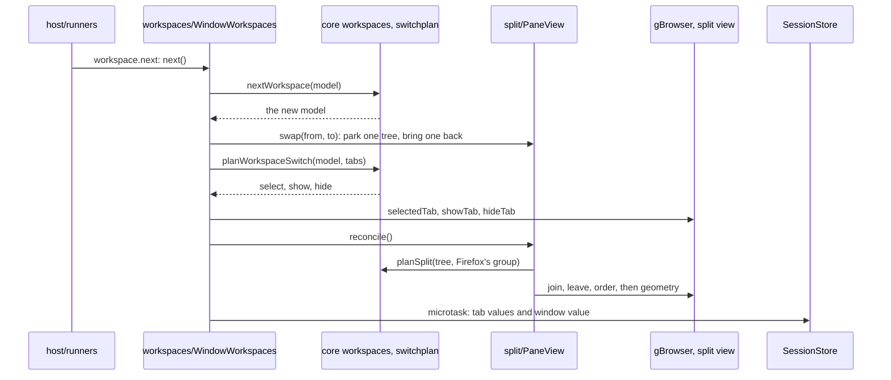

# Workspaces and panes: from a key to a restored window

This page follows a workspace switch through the code, and then what keeps it across a restart.
The example is `ctrl+b )`, the next workspace, in a window whose target workspace holds a split:
it reaches the pure models in vimma-core, each window's mirror of them over Firefox's tabs,
containers and split view, and the two places the state is saved.
[ARCHITECTURE.md](../../ARCHITECTURE.md) lists the folders and where the state lives; the
behaviour is in [m3-workspaces](../specs/m3-workspaces.md),
[m3-m4-core-models](../specs/m3-m4-core-models.md), [m3-m4-core-prep](../specs/m3-m4-core-prep.md),
[m4-split-panes](../specs/m4-split-panes.md), [multiple-splits](../specs/multiple-splits.md),
[tiling-layouts](../specs/tiling-layouts.md), [workspace-routing](../specs/workspace-routing.md)
and [private-workspace](../specs/private-workspace.md), the split view decision in
[ADR-013](../adr/013-split-on-firefox-split-view.md), and the rules with their tests in
[docs/security/](../security/README.md) §2 (routing) and §3 (deletion and containers). How the key
reaches its runner: [The life of a keypress](keypress.md).

## The models: pure, in vimma-core

Every rule about what a workspace or a pane holds is a pure function in
`packages/vimma-core/src/`, which returns a new frozen state, or its input for a no-op:

- `workspaces.mjs`: a window's workspaces in order, each with an id, a name, its container
  (opaque to core), its ordered tab ids, its selected tab and its splits, plus the active
  workspace and the alternate one (`ctrl+^`). `openTab`, `closeTab`, `selectTab`, `moveTab`,
  `switchWorkspace`, `nextWorkspace` and the rest.
- `panes.mjs`: one pane tree, splits and leaves, one tab per leaf, each split with an axis and
  ratios of at least `MIN_RATIO` (0.1); `split`, `closePane`, `focus`, `swap`, `toggleZoom`,
  `resize`, and `layout`, which turns a tree and a rectangle into one rectangle per pane. At most
  8 panes by default, 16 at most (`[panes] max`).
- `splits.mjs`: several numbered trees per workspace, at most one of them shown
  ([multiple-splits](../specs/multiple-splits.md)); `layouts.mjs`: tmux's presets and Hyprland's
  dwindle as builders over a tree.
- `switchplan.mjs` (`planWorkspaceSwitch`) and `splitplan.mjs` (`planSplit`): the planners. Each
  compares the model with a plain description of Firefox's tabs and returns the operations that
  make Firefox match, so the host only applies them, and a plan also repairs drift (a tab of
  another workspace left visible by an extension).
- `workspacedefs.mjs`: the app's list of workspace definitions (id, name, container, colour,
  icon) and its reconcile with `config.toml`'s `[workspaces]`; `snapshot.mjs`: the versioned JSON
  of one window's state.

Tests: [workspaces.test.mjs](../../packages/vimma-core/test/workspaces.test.mjs),
[panes.test.mjs](../../packages/vimma-core/test/panes.test.mjs),
[splits.test.mjs](../../packages/vimma-core/test/splits.test.mjs),
[switchplan.test.mjs](../../packages/vimma-core/test/switchplan.test.mjs),
[splitplan.test.mjs](../../packages/vimma-core/test/splitplan.test.mjs), and the fixtures in
`tests/contract/state/` and `tests/contract/workspaces/`, read by
[snapshot.test.mjs](../../packages/vimma-core/test/snapshot.test.mjs) and
[workspacedefs.test.mjs](../../packages/vimma-core/test/workspacedefs.test.mjs).

## The mirror: one per app, one per window

- `workspaces/WorkspaceStore.sys.mjs`, one per app, owns the definitions and their containers. A
  workspace is a Firefox container (a `userContextId`), so its cookies and site data are its
  own. `init` loads `<profile>/vimma-workspaces.json` through Firefox's `JSONFile`, reconciles it
  with `[workspaces]` (`reconcileDefinitions`), and creates or updates the containers
  `planContainers` asks for. With the pref `privacy.userContext.enabled` off, workspaces are
  disabled and the status bar says so (`CONTAINERS_OFF_ALERT`).
- `workspaces/WindowWorkspaces.sys.mjs`, one per window (`VimmaHost.init` starts it), holds the
  window's model and keeps it in step with Firefox's tab events (`TabOpen`, `TabClose`,
  `TabSelect`, `TabPinned`, `TabUnpinned`). Only the active workspace's tabs are visible: the
  others are hidden with `gBrowser.hideTab`. A new tab joins the workspace that owns its
  container; a tab in a container no workspace owns joins the active one and is marked foreign. A
  tab pinned outside Vimma is unpinned with a notice, since `hideTab` refuses pinned tabs.
- `split/PaneView.mjs`, one per window (`PaneViews.init` in `vimma.js`), holds the shown pane tree,
  keyed by each tab's `linkedPanel` (the id Firefox's split view works with; a lazy tab gets one
  when it is inserted, and panels do not survive a restart, hence the uuids below), mirrors it onto
  one of Firefox's own split views (ADR-013), and parks the trees of the workspaces not shown.
  `split/layout.mjs` puts each panel at its rectangle with CSS.

A tab opened without a container, and not pinned, takes one from `Tabbrowser-sys-mjs.patch`:
its opener's container first, else `WorkspaceStore.defaultUserContextId`, which answers with the
window's active workspace's container, else the most recent browser window's, else the
`lastActive` workspace's. A URL from the command line (`fromExternal`) gets
`nonAgentUserContextId`, never the agent workspace's, and a new window's first tab
`firstTabUserContextId`. Private windows and popups get none, so Firefox's own behaviour stays
there. Tests: `new_tabs_without_a_container_take_the_active_workspaces` and
`gate1_a_login_in_one_workspace_is_invisible_in_another` in
[browser_vimma_workspace_routing.js](../../tests/browser/browser_vimma_workspace_routing.js);
`containers_off_disables_workspaces` in
[browser_vimma_workspace_store.js](../../tests/browser/browser_vimma_workspace_store.js).

## 1. The switch

`workspace.next` is `workspaceStep("next")` in `host/runners.mjs`. From the private workspace it
leaves private instead (see the last section); otherwise it calls `WindowWorkspaces.next`, which
asks core's `nextWorkspace` for the next model, skipping the agent workspace, and hands both
models to `#show`:

1. `PaneView.swap(from, to)` parks the shown tree, with its split number and the window's other
   splits, under the workspace left, and takes the target's parked tree back, if it has one.
2. A target with no tab gets its home page in its own container (`#openHome`).
3. `planWorkspaceSwitch` compares the model with the window's tabs and returns the tab to select
   and the tabs to show and hide; `#show` selects first, then calls `showTab` and `hideTab`.
4. `PaneView.reconcile` (below) puts the target's split back on screen, and `adopt` takes in or
   undoes splits made outside Vimma, such as one whose tabs span workspaces.
5. When the active workspace changed, `WorkspaceStore.setActive` records it as `lastActive` for
   the next start, and `#changed` tells the side panel and the status bar, then schedules a save.

Tests: `prefix_parens_show_one_workspace_and_restore_its_tab` and
`a_split_hides_as_a_whole_and_comes_back_laid_out` in
[browser_vimma_workspace_switching.js](../../tests/browser/browser_vimma_workspace_switching.js);
`each_workspace_keeps_its_panes_and_focus_across_switches` in
[browser_vimma_pane_workspaces.js](../../tests/browser/browser_vimma_pane_workspaces.js).

## 2. The split view

A pane key (`ctrl+b v`, `ctrl+b -`) reaches `host/pane-ops.mjs`, which calls `PaneView.split`: it
refuses while the split is hidden and wherever core's `splitRefusal` says no (`[panes] max`, or
no room next to the focused pane), opens
the new tab in the background, and sets the tree that core's `split` returns. Every change, and
every switch, ends in `PaneView.reconcile`:

1. A tree whose tabs closed behind its back shrinks first.
2. `planSplit` compares the tree with Firefox's split group (its members, which are active,
   which are hidden) and returns which tabs join, leave, move, show and hide.
3. The focused pane's tab is selected, the membership and the order are applied, and the
   geometry: core `layout` gives each pane a rectangle in the content area, and
   `split/layout.mjs` (`applyLayout`) places the panels. A hidden split's pages are made inactive
   instead, so they stop painting.
4. `onChange` tells `WindowWorkspaces`, which schedules a save.

Firefox decides which browsers are live and which tab is selected; the tree decides the geometry.
Tests: [browser_vimma_split_contract.js](../../tests/browser/browser_vimma_split_contract.js),
for example `a_two_by_two_grid_of_four_tabs_puts_every_active_panel_at_its_rect`;
[browser_vimma_pane_keys.js](../../tests/browser/browser_vimma_pane_keys.js).

## 3. Saving

Two places hold the state, written at different times:

- **The app's definitions**, in `<profile>/vimma-workspaces.json`. `WorkspaceStore.#save` hands
  them to `JSONFile` (`saveSoon`: debounced, written atomically, with a `.bak` copy and a flush at
  shutdown). A file with a newer schema is never overwritten (`canWriteDefinitions`, also checked
  again just before each write); the store then keeps it read-only in memory. A file that is
  JSON but not valid definitions is copied aside as `.corrupt-<time>` and the store starts empty.
  The store also caches the last user workspace's container in a pref, so a cold start can give
  the first tab a container before the file is read.
- **Each window's state**, in Firefox's SessionStore. `WindowWorkspaces.#save` runs in a microtask
  after any change, and at once when the window closes (`SSWindowClosing`) and as a restore into it
  begins: each tab of the model (pinned tabs are not in it) gets a uuid in the tab value `vimma-tab`
  and its workspace in `vimma-workspace`, and the window value `vimma-workspaces` gets core's
  snapshot (`toSnapshot`: the order, each workspace's selected tab, the pane trees with uuids in
  place of panels, the tab labels). It writes nothing while a restore is under way, nor over a
  window value from a newer schema (`canWrite` in `snapshot.mjs`). A snapshot that fails its own
  check is written without the pane trees.

Tests: `save_and_load_round_trip` and `a_newer_file_is_never_overwritten` in
[browser_vimma_workspace_store.js](../../tests/browser/browser_vimma_workspace_store.js);
`a_newer_window_value_is_left_untouched` in
[browser_vimma_workspace_restore.js](../../tests/browser/browser_vimma_workspace_restore.js).

## 4. The restore

At startup `vimma.js` calls `WorkspaceStore.init` without waiting for it: a tab that asks for its
container before the file is loaded gets the cached container, or a synchronous read of the file.
`WindowWorkspaces` waits for the store and the window's document, then reconciles, unless a
restore into the window is already under way.

Firefox's SessionStore brings back the tabs, each in its container, with their tab and window
values. It brackets a restore into a window with `SSWindowStateBusy` (or `SSWindowRestoring`)
and `SSWindowStateReady`. In between, `WindowWorkspaces` applies no tab event to its model
(`WorkspaceRouter.adoptTab` still sees each `TabOpen`) and saves nothing. The bracket also ends
on the `sessionstore-single-window-restored` notification, and a timer of `STUCK_RESTORE_MS`
(5 s at present) ends one that never closes. On Ready, `#reconcile`
runs `#rebuild`, and keeps the old model if the rebuild throws:

1. The tab ids are read again from `vimma-tab`.
2. The window value is read with `readSnapshot`, unless it is the one this window wrote or comes
   from a newer schema.
3. A fresh model is built from the live tabs, which are the truth, over a base: the snapshot, or
   the window's current model when there is none. Each tab goes to the workspace that owns its
   container, else the one the base or its `vimma-workspace` value names, else the base's active
   one; pinned tabs stay out. Each workspace's selected tab and the alternate come from the base,
   and the active workspace is the one of the live selected tab.
4. The tab labels come back, and `#restorePanes` hands every workspace's splits to
   `PaneView.restore`, with each uuid turned back into a panel.
5. `#show` applies the result as a switch does.

Tests: `gate_2_workspaces_tabs_panes_labels_and_scroll_come_back`,
`a_whole_window_restore_is_never_cut_short_by_the_stuck_bound` and
`a_failed_reconcile_keeps_the_windows_tabs` in
[browser_vimma_workspace_restore.js](../../tests/browser/browser_vimma_workspace_restore.js);
`a_session_restore_brings_back_every_workspaces_layout_and_focus` in
[browser_vimma_pane_workspaces.js](../../tests/browser/browser_vimma_pane_workspaces.js); the e2e
scenarios `m3-restart-restore` and `m3-crash-restore`, which restart a real build on the same
profile.

## Routing: which workspace a new tab opens in

`workspaces/WorkspaceRouter.sys.mjs` applies `config.toml`'s `[[routes]]` rules (core
`routes.mjs`, `matchRoute`), which `ConfigHost` hands it with `setRoutes`; it keeps a copy in a
pref, so a cold start routes before `config.toml` is read. It only chooses the container of a tab
or window being created, and never moves one, so routing cannot loop. Three patches call it:
`URILoadingHelper-sys-mjs.patch` (`routeLinkIn`: the address bar, `:open`, bookmarks, and links a
page opens in a new tab or window), `BrowserDOMWindow-sys-mjs.patch` (`externalUserContextId`,
`externalWhere`: links from other apps), and `Tabbrowser-sys-mjs.patch` through
`WorkspaceStore.firstTabUserContextId` (a new window's first tab). Links from other apps and new
windows never take the agent workspace's container. `vimma-open` names the programs that opened
a link with `-vimma-from`, for rules with `app`
([app-routes](../specs/app-routes.md)). Tests:
[browser_vimma_workspace_routes.js](../../tests/browser/browser_vimma_workspace_routes.js),
[routes.test.mjs](../../packages/vimma-core/test/routes.test.mjs), and R1 onwards in
security.md §2.

## The private workspace

The private workspace is Firefox's own private window, shown as one more workspace; every
privacy guarantee is Firefox's. `host/private-ops.mjs` finds, opens, focuses and closes those
windows, and core `privatews.mjs` holds the rules: `ctrl+b )` and `ctrl+b (` never enter it, a tab
moves in only after a question and never out, and Vimma keeps what it knows of it in memory
only; that the pages leave nothing on disk is Firefox's private browsing guarantee. Inside a
private window `WindowWorkspaces` does not start, `WorkspaceStore` gives no container, and
`WorkspaceRouter` routes nothing; `PaneView` works there as anywhere. On Hyprland,
`host/private-swap.mjs` swaps the private window into the normal window's place over Hyprland's
IPC ([private-swap](../specs/private-swap.md), [ADR-017](../adr/017-window-manager-ipc.md)); on
macOS `host/native-swap.mjs` does it with Firefox's own window calls
([private-swap-macos](../specs/private-swap-macos.md)). Tests:
[browser_vimma_private_workspace.js](../../tests/browser/browser_vimma_private_workspace.js),
for example `nothing_private_reaches_the_normal_profile`; the Hyprland swap against a fake
Hyprland in [browser_vimma_private_swap.js](../../tests/browser/browser_vimma_private_swap.js).
